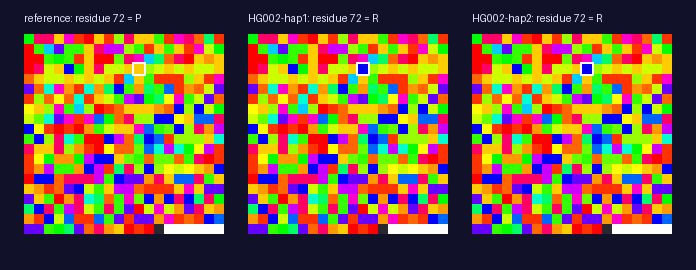

# 02. pxil pictures from a gpxil genome: a person's own proteins

**Question.** Can gene, transcript and protein pictures (pxil files) be made
from a gpxil file, bringing in the annotation they need, both for the
reference and for each of a person's two haplotypes?

**Answer: yes.** The package is in [`packages/gpxil2pxil`](../../packages/gpxil2pxil),
ready to become a repository of its own and go on PyPI.

## What it does

`gpxil2pxil FILE GENE` writes a gene's genomic sequence, its transcripts'
spliced sequences and their proteins as pxil files, named with the Ensembl
IDs. Where the file holds a sample, it writes them for each haplotype too,
by applying the sample's genotypes to the reference, as gpxiltools does.
Each protein is translated from the annotated start codon until the first
stop, so frameshifts are followed. The file's metadata says how the protein
differs from the reference.

The annotation comes from one of two places:
- **The Gpxil browser's gene files**, read from the web a gene at a time:
  the index (about 1 MB), the contig's gene list, then a range request for
  just that gene's transcripts. These cover every Ensembl 116 transcript on
  GRCh38, with protein IDs and selenocysteines.
- **Any GTF file**, from Ensembl or GENCODE.

## A real example: HG002's TP53

HG002's chr17 was encoded from the GIAB v4.2.1 benchmark, using gpxiltools
0.3's new ability to take a gpxil file as the reference (the Gpxil browser's
chr17, no FASTA needed). It took 26 s and gave 24.6 MB:

```sh
gpxil encode chr17.gpxil.tif -v HG002_GRCh38_1_22_v4.2.1_benchmark.vcf.gz \
    --callable HG002_GRCh38_1_22_v4.2.1_benchmark_noinconsistent.bed --contigs chr17 -o HG002_chr17.gpxil.tif
gpxil2pxil HG002_chr17.gpxil.tif TP53 --haplotypes all -o HG002-TP53
```

```
wrote HG002-TP53/TP53-201_ENSP00000269305.protein.pxil.png (394 amino acids)
wrote HG002-TP53/TP53-201_ENSP00000269305_HG002-hap1.protein.pxil.png (394 amino acids): differs from the reference: P72R
wrote HG002-TP53/TP53-201_ENSP00000269305_HG002-hap2.protein.pxil.png (394 amino acids): differs from the reference: P72R
```

HG002 is homozygous for TP53's Arg72 (rs1042522), the commoner allele, where
the reference has Pro72. The pictures show it as one pixel: Taylor's orange
for proline, blue for arginine.



The nine files are in [`HG002-TP53/`](HG002-TP53/). In the same run, BRCA1's
canonical protein came out the same as the reference on both of HG002's
haplotypes.

## Checks

The tests use a made-up genome whose genes, transcripts and variants are
known exactly:
- a plus-strand gene with three exons and a selenocysteine;
- a minus-strand gene;
- a missense change, a frameshift, a change on both haplotypes, and an
  insertion in an intron.

The tests check:
- the reference and haplotype sequences against ones built by hand;
- the GTF reader against the browser-format reader;
- the file names and metadata;
- the command line.

They also check TP53 against the live Gpxil browser. All pass.
