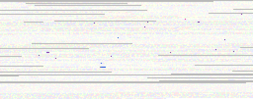

# 03. Comparing genomes base by base: two call sets, and a child with both parents

**Question.** Gpxil files on the same reference have their planes aligned to
it base for base. Can two genomes then be compared as arrays, without matching
VCF records, and still come out right where the same variant is written
differently: an insertion anchored at the other end of a repeat, say? And can
a child be checked against both parents the same way?

**Answer: yes**, once three things were found here and put into
`gpxil compare` (gpxiltools 0.5):

1. **Calls outside the regions called with confidence are left out.** A file
   encoded with a BED file of such regions keeps the VCF's calls outside them
   too (spec 6.1), each an island of called bases among bases not called. In
   the first run of the trio they made 97 Mendelian errors, almost all of
   them where one of the three wasn't called with confidence; without them,
   23 are left, and every one lies inside all three BED files.
2. **Stretches are widened over repeats.** Where two files differ, bases no
   more than 50 apart form a stretch, and the stretch counts as the same if
   both files spell the same sequences over it. At first that found an indel
   moved along a repeat only when the two places were no more than 50 bases
   apart (600 of 600 such repeats, 0 of 206 longer ones); widening each
   stretch over the repeat its insertions and deletions could move along
   found all 806.
3. **Phasing isn't compared, so pieces of a stretch can be turned round on
   their own.** A file's two haplotypes are tried with their heterozygous
   pieces either way round. Records next to each other (a deletion, then a
   substitution) and an insertion at a base that the other haplotype deletes
   are separate pieces, as an unphased VCF allows.

And one thing for the specification (below): spec 0.1 puts overlapping
unphased heterozygous calls on the same haplotype, so two deletions the VCF
means to be on different haplotypes become one. It happened once in each of
the GIAB comparisons.

## What `gpxil compare` does

```sh
gpxil compare A.gpxil.tif B.gpxil.tif [--region chr17:7,661,779-7,687,546] [-o picture.png]
gpxil compare CHILD.gpxil.tif --father FATHER.gpxil.tif --mother MOTHER.gpxil.tif
```

**Two genomes.** At each base called in both, the genotypes are compared as
unordered pairs of alleles (an allele is the base's state, with any bases
inserted after it): A/G equals G/A, phased or not, and one copy equals two
copies of one allele. Where they differ, stretches are spelled out and
compared as sequences, as above. Each file's events, counted as `gpxil stats`
counts them, are then looked for in the other: found, missing, or there with
another genotype; not compared where the other file didn't call. Taking B as
the truth gives precision, recall and F1, by substitutions, indels and
COMPLEX alleles. The JSON gives every count and the first 20 differences.

**A child and both parents.** At each base called in all three, the child's
alleles must be one from each parent (or, with one copy, from either). Where
they aren't, the stretch around the error, with every variant of the three
near it, is spelled out: if the child's two sequences can be one of the
father's and one of the mother's, the three only write it differently.
Otherwise it is a Mendelian error, and a candidate new mutation if the child
has an allele neither parent has. Where only one way of taking an allele from
each parent fits, a variant's parent of origin is known. Where a parent's
calls are phased, the child's genotype often shows which of that parent's
haplotypes it received, and a change from one to the other along a phase set
is a crossover (counted when at least three sites in a row back each side).

The picture is one pixel a base, the classes over the reference faded:



*TP53 (chr17:7,661,779-7,687,546), 256 bases a row, two pixels a base: blue,
from the father; purple, from both; olive, from either; grey, not called in
all three. In TP53, HG002 has no Mendelian error.*

Both read the files a megabase at a time, cut where no file has a variant
nearby, so a whole chromosome takes little memory: chromosome 17 took 2.0 s for
two genomes and 2.1 s for a trio ([`results/giab.json`](results/giab.json)),
and about 10 s each in the browser, in GpxilStudio. Only the bases where a
file has something other than the reference's base are looked at one by one.

## Indels in repeats (`repeats.py`)

Homopolymers and repeats of 2, 3 and 4 bases, 8 to 160 bases long, each with
an insertion or deletion of one or two units written at two places in two
files (left end and right end, left end and middle, middle and right end),
heterozygous or homozygous, some with a heterozygous substitution nearby that
file A phases on the other haplotype and B leaves unphased. Controls write a
different change in B: two units for one, a deletion for an insertion, or an
inserted unit with one base changed.

| bases between the two places | repeats | the same, gap 50 | the same, gap 200 |
|---|---:|---:|---:|
| 1-10 | 199 | 199 | 199 |
| 11-50 | 401 | 401 | 401 |
| 51-100 | 166 | 166 | 166 |
| 101-200 | 40 | 40 | 40 |
| controls (a different change) | 110 | 0 | 0 |

Before the stretches were widened over repeats, the rows for 51-100 and
101-200 were 0 at gap 50, as expected; `--gap` remains, for differences that
are far apart without a repeat between them. The full table is
[`results/repeats.md`](results/repeats.md).

## HG002, two benchmark versions (`giab.py`)

GIAB's v4.2.1 and v5.0q small-variant benchmarks of HG002, chromosome 17, in
the regions both call with confidence:

```
A HG002_chr17.gpxil.tif (HG002), B HG002_chr17_v5.0q.noref.gpxil.tif (HG002) · GRCh38

chr17:1-83,257,441 · 83,257,441 bases
  called          in both 69,701,707 (83.72 %) · in A only 2,601,502 · in B only 3,712,114 · in neither 7,242,118
  variant bases   113,164 called in both with a variant in either
                  the same 113,156 (> 99.99 %), of them written differently 410
                  only in A 5 · only in B 0 · another genotype 3
  substitutions   A 89,648: found in B 81,934 · not in B 4 · another genotype 0
                  B 120,574: found in A 82,041 · not in A 0 · another genotype 1
                  precision > 99.99 % · recall > 99.99 % · F1 > 99.99 % (B as the truth)
  indels          A 18,698: found in B 15,691 · not in B 0 · another genotype 2
                  B 34,439: found in A 15,610 · not in A 0 · another genotype 1
                  precision 99.99 % · recall > 99.99 % · F1 > 99.99 % (B as the truth)
```

([`results/pair.txt`](results/pair.txt). Counting the calls outside the BED
files too, the agreement was 95.88 %, with 445 variant bases only in A and
4,636 only in B.)

**Checked from the VCF records.** The two differ base by base in 85 stretches.
Each was spelled out again from the VCF records with pysam, without
gpxiltools: every record over the stretch, alleles trimmed of the bases they
share with REF, heterozygous records placed either way round, `*` alleles
left to the deletion they refer to. The two ways agree on 84 of the 85
([`results/pair-stretches.json`](results/pair-stretches.json)): 82 the same,
written differently, and 2 different (a substitution at 21,290,549 and one at
21,290,701 that only v4.2.1 has). The other is the specification's:

```
72,809,199   v4.2.1  TTC>T 0/1, CT>C 0/1 (at 72,809,201), CT>C 0/1 (at 72,809,203)
             v5.0q   TTC>T 1|1, T>C 0|1 (at 72,809,204)
```

The first two v4.2.1 records overlap (the second's anchor is a base the first
deletes), so they can't be on one haplotype; written on different ones, the
two versions are the same. Spec 0.1 applies unphased genotypes as written,
both ALT alleles to haplotype 2, where the two deletions become one run of
three deleted bases, and the information that they were two records is gone.

## HG002 with HG003 and HG004

GIAB's v4.2.1 benchmarks of the Ashkenazi trio, chromosome 17, each with its
`noinconsistent` BED file:

```
child HG002_chr17.gpxil.tif (HG002), father HG003_chr17.gpxil.tif (HG003), mother HG004_chr17.gpxil.tif (HG004) · GRCh38

chr17:1-83,257,441 · 83,257,441 bases
  called              in all three 70,180,589 (84.29 %)
  child's variants    106,558 bases
                      from the father 28,419 · from the mother 27,061 · from both 40,337
                      from either, can't be told 10,716
  Mendelian errors    23 sites (24 bases), 23 of them candidate new mutations
  written differently 1 stretch (1 base) consistent as sequences, not base by base
  father's haplotypes not phased, so which one the child received isn't known
  mother's haplotypes not phased, so which one the child received isn't known
```

([`results/trio.txt`](results/trio.txt), every error in
[`results/trio-errors.json`](results/trio-errors.json).)

All 23 errors lie inside all three BED files, and in each the child carries
an allele neither parent has: 21 substitutions (11 of them C>T or G>A, as new
mutations mostly are; one pair of neighbouring bases, and three within 82
bases at 58,332,214-58,332,296), one deleted base, and one artefact of the
specification, at 77,145,099: HG002 has two overlapping deletions, unphased,
that spec 0.1 joins on one haplotype, as above, where the VCF has one on each.

**Checked from the VCF records.** Record by record, where all three are called
with confidence, a child's record is checked against the parents' records at
the same position (REF/REF without one): 129,035 consistent, 23 inconsistent,
and 1,541 that couldn't be checked that way because records overlap or are
written differently. The 23 are the same sites as gpxil compare's, but for
77,145,099 (overlapping, so not checked that way) and the second base of the
neighbouring pair, which is one site to `gpxil compare`.

The parents' benchmarks are unphased, so no crossovers can be seen in them;
the tests check crossovers with made-up phased parents.

## For the specification (0.2)

Unphased heterozygous calls that overlap can't be on one haplotype, yet spec
0.1 (sections 6.4 and 6.5) applies each as written, ALT to haplotype 2, so
their alleles meet there: two overlapping deletions become one. Spec 0.1
already swaps the alleles of an unphased call with a `*` allele so that the
`*` lands on the haplotype with the deletion; a like rule could put an
unphased heterozygous call whose ALT would meet another call's asserted state
on haplotype 1 instead, where that is free.

## Running it

```sh
python3 repeats.py                       # 1 s; results/repeats.md
python3 giab.py DATA GPXIL_DIR           # 1 min; results/
```

`giab.py` needs pysam, the GIAB files in `DATA` (`giab/`, `giab5/`,
`giab-trio/`) and the four gpxil files of chromosome 17 in `GPXIL_DIR`, made
with gpxiltools from the Gpxil browser's chr17 (no FASTA needed):

```sh
gpxil encode chr17.gpxil.tif -v HG003_GRCh38_1_22_v4.2.1_benchmark.vcf.gz \
    --callable HG003_GRCh38_1_22_v4.2.1_benchmark_noinconsistent.bed --contigs chr17 -o HG003_chr17.gpxil.tif
gpxil encode chr17.gpxil.tif -v HG002_GRCh38_v5.0q_smvar.vcf.gz \
    --callable HG002_GRCh38_v5.0q_smvar.benchmark.bed --contigs chr17 --no-ref -o HG002_chr17_v5.0q.noref.gpxil.tif
```

The GIAB files are from
[GIAB's releases](https://ftp-trace.ncbi.nlm.nih.gov/ReferenceSamples/giab/release/AshkenazimTrio/):
`HG002_NA24385_son` (v4.2.1 and v5.0q), `HG003_NA24149_father` and
`HG004_NA24143_mother` (v4.2.1), GRCh38.
