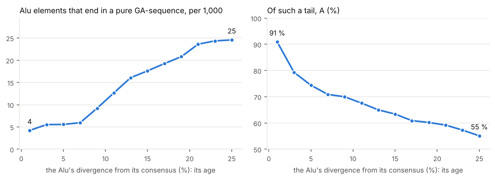
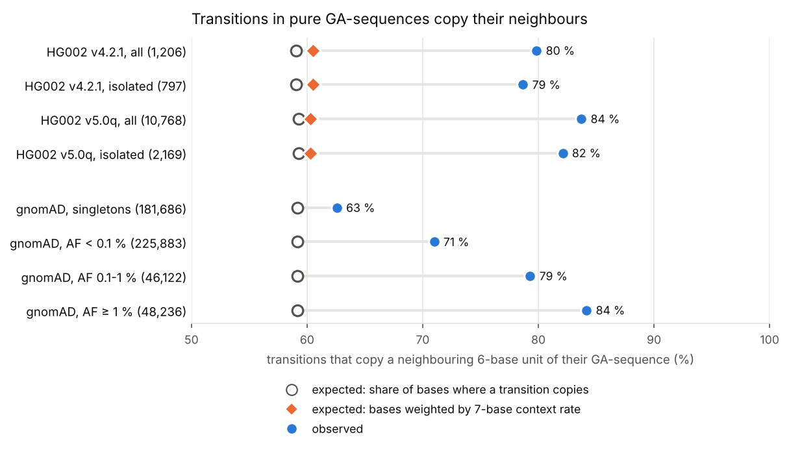

# 04. Pure GA-sequences: where they come from, and how they change

**Question.** Guenter Albrecht-Buehler drew genomes as pictures, one pixel a
base, and in them found *pure GA-sequences*: stretches of more than 50 bases
of nothing but G and A, tens of thousands of them in mammalian genomes,
though chance would give almost none
([PLoS ONE 2008](https://doi.org/10.1371/journal.pone.0003818)). He saw
Alu elements line up upstream of those that start with poly(A), and he
reported that they "contained many times fewer point mutations than one
should expect from the genome at large" (160 times fewer, until a
[correction](https://www.ncbi.nlm.nih.gov/pmc/articles/PMC2646294/) found a
flaw in the calculation). He proposed that they are signposts
of a system that guides proteins through the genome
([PLoS ONE 2009](https://doi.org/10.1371/journal.pone.0004701), the paper
that introduced the genome pixel image gpxil is named after). He had the
reference sequence alone. With gpxil files of GRCh38 and of a person's own
genome, the repeat annotation, and the variants of 76,215 people, what can be
said of where they come from and how they change?

**Answers.**

1. **They are where he said, and as many.** GRCh38 has 22,726 pure
   GA-sequences and 22,955 pure TC-sequences (the GA-sequences of the other
   strand: as many, as Chargaff's second rule expects). Half are 73 bases or
   less; the longest is 1,303 ("up to 1300", he wrote); 0.3 % are runs of one
   base. chr1 has 1,766 (his count, on an older assembly: 1,667).
2. **Most are the tails of Alu elements, or repeats that began as such.**
   37 % start where an Alu element ends, on the same strand; a third are
   simple repeats, a fifth low-complexity sequence. Of those that start with a
   poly(A) of 15 or more, 71 % are Alu tails: not all, as he said, but most.
   **And they get older as Alu elements age.** The older the Alu (the more it
   has diverged from its consensus), the more often its tail is a pure
   GA-sequence (from 4 per 1,000 Alu elements diverged less than 2 %, to 24
   per 1,000 of those diverged 20 to 26 %), and the less of the tail is A: the
   youngest tails are 91 % A, in runs of 49; the oldest, 55 to 60 %, in runs of
   5. Poly(A) tails turn into GA-repeats with time, as
   [figures/alu_tails_three_ages.png](figures/alu_tails_three_ages.png) shows.
3. **They don't have many times fewer point mutations.** He counted the
   substitutions that would break a GA-sequence: the transversions, A or G to
   C or T. New mutations, the singletons among gnomAD's 76,215 genomes, occur
   in GA-sequences at the rate their trinucleotide contexts predict (1.00
   times; transversions 0.96 times), and HG002's isolated substitutions at 0.9
   to 1.1 times (in GIAB's v4.2.1 and v5.0q benchmarks). With no CpG in them,
   the most mutable pairs, a GA-sequence has fewer substitutions per base than
   the genome on average, and that is all. Commoner variants lean towards
   transitions, which keep a GA-sequence pure: HG002's isolated transitions run
   at 1.1 to 1.6 times what their contexts predict, its transversions at about
   half (0.44 to 0.58 times). What GA-sequences have is **19 to 24 times as
   many insertions and deletions** as the rest of HG002's genome (in gnomAD,
   28 times as many indel alleles a base), as microsatellites do.
4. **Their substitutions copy their neighbours, the more so the commoner they
   are.** Inside them, substitutions are transitions (A↔G) far more than
   elsewhere: 80 % (v4.2.1) and 88 % (v5.0q) of HG002's, against 68 % and 67 %
   over all the bases each benchmark calls. And a transition sits where it
   turns its 6 bases into 6 bases found elsewhere in the same GA-sequence much
   more often than chance: 80 % of HG002's (v4.2.1), where 59 % of the bases
   would (p = 4 × 10⁻⁵³); 79 % of isolated ones. Weighting each base by the
   rate of transitions in its 7-base context changes the expectation to 60 %;
   taking the 6-base words of another GA-sequence of the same length instead
   removes the excess (50 %, against 49 %): it is the sequence's own units
   that are copied. v5.0q, which holds twice as many GA-sequence bases, gives
   82 % of 2,169 isolated transitions. In gnomAD, the commoner a transition,
   the more often it copies a unit: 63 % of singletons, 71 % of variants rarer
   than 0.1 %, 79 % of those to 1 % and 84 % of commoner ones, where 59 % of
   the bases would (p < 10⁻¹⁹⁷ each); at the sites called in 90 % of its
   genomes or more, 64 % to 77 %.

**What it means.** Pure GA-sequences look like microsatellites that start as
the poly(A) tails of Alu elements and change by copying their own units, the
way repeats change by slippage and gene conversion, rather than like
protected signposts. New point mutations reach them at the usual rate; the
substitutions that become common are mostly transitions that copy a
neighbouring unit, whether because such a change recurs, templated by its
neighbour, or because it is favoured. Albrecht-Buehler himself, the same
year, measured point mutations as the differences between consecutive
periods of repeats, and proposed "auto-mutagenic mechanisms" involving "the
inter-conversions of nucleotides"
([BioEssays 2009](https://doi.org/10.1002/bies.080081)). In his
GA-sequences, people's variants show such changes, and that each takes its
pattern from a neighbouring unit.

## How it was done

The genomes were read from gpxil files: GRCh38 from the
[Gpxil browser](https://comparativechrono.github.io/Gpxil-browser/)'s
per-chromosome files, and HG002's two GIAB benchmarks (v4.2.1, and the
assembly-based v5.0q), encoded with gpxiltools 0.7 one autosome at a time,
without the reference plane (29 MB for v4.2.1's 22 files). Each base's
planes are arrays aligned to the reference, so a question about every pure
GA-sequence is a few lines of NumPy over its offsets. The repeats are
UCSC's RepeatMasker table for hg38; gnomAD's variants were read from its
public VCF files a region at a time.

| Script | What it does | Output |
|---|---|---|
| [`census.py`](census.py) | the pure GA- and TC-sequences of GRCh38, and the "common" ones (more than 20 bases) | `results/ga-sequences.GRCh38.bed.gz`, `results/census.json` |
| [`stack.py`](stack.py) | his GA-complex image: a row per GA-sequence, 400 bases upstream and its first 200, sorted by the poly(A) it starts with | `figures/stack_chr1*.png` |
| [`stripes.py`](stripes.py) | an image measure of the Alu pattern upstream, no alignment: each row against the column consensus of the poly(A) rows | `results/stripes.json` |
| [`alu.py`](alu.py) | each GA-sequence against GRCh38's RepeatMasker annotation: Alu tails, other repeats; Alu tails by the poly(A) they start with, by subfamily and by divergence | `results/alu.json`, `results/ga-sequences.origin.tsv.gz`, `figures/alu_tails_*.png` |
| [`variants.py`](variants.py) | HG002's variants inside, in the 400-base flanks and in all callable bases, per base pair class, against trinucleotide contexts; isolated substitutions (no other variant within 20 bases) apart | `results/variants_*.json` |
| [`unit_copy.py`](unit_copy.py) | whether HG002's transitions copy a neighbouring unit (k = 4, 5, 6) | `results/unit_copy_*.json` |
| [`controls.py`](controls.py) | the same, weighted by the transition rate of each 7-base context, and with another GA-sequence's words | `results/controls_*.json` |
| [`gnomad.py`](gnomad.py) | the tests on gnomAD v4.1's genomes (PASS), read from the web a region at a time, against 10,000 random 100-base windows away from GA-sequences; each by allele frequency | `results/gnomad.json`, `results/gnomad_counts.tsv.gz` |
| [`check_gnomad.py`](check_gnomad.py) | 300 of those regions read again with another reader, their records counted: a read cut short without an error would show | `results/gnomad_check.json` |
| [`unit_image.py`](unit_image.py), [`figures.py`](figures.py) | the pictures | `figures/` |

In HG002, a substitution is counted at a base where either haplotype
carries another base, an indel where a run of deleted bases starts or an
insertion follows a base, within the regions the benchmark calls with
confidence. Expected counts
come from the rate of each substitution in each trinucleotide context (read
with a purine in the middle) over all callable bases of the 22 autosomes. A
TC-sequence is read on its purine strand, reverse-complemented.

## Results

### The census

| | GA | TC |
|---|---|---|
| pure (more than 50 bases) | 22,726 | 22,955 |
| common (more than 20 bases) | 324,372 | 326,455 |

4.2 Mb in all: among the autosomes, from 12 a megabase on chr13 to 31 on
chr19 (17 on chrX, 34 on chrY's sequenced bases). The densest chromosomes are
the richest in Alu elements.

### Where they come from

[figures/stack_chr1_labelled.png](figures/stack_chr1_labelled.png) is his
image of GA-complexes, redrawn: chr1's 1,766 GA-sequences, each with its 400
upstream bases, sorted by the poly(A) each starts with. The top rows, with a
poly(A) of 15 or more, line up into vertical stripes upstream: the bodies of
Alu elements. Scored without alignment, half of those rows have the pattern
(193 of 383 on chr1, 139 of 257 on chr7, 140 of 290 on chrX), against 1 to
3.4 % of the rows without a poly(A); TC-sequences score about the same on
their strand (44 to 55 %). RepeatMasker says more of them are Alu tails:

| Starting with a poly(A) of | GA-sequences (autosomes) | Alu tails | |
|---|---|---|---|
| 15 or more | 8,388 | 5,932 | 70.7 % |
| 5 to 14 | 21,208 | 7,978 | 37.6 % |
| less than 5 | 12,566 | 1,788 | 14.2 % |

| Origin (42,162 on the autosomes) | | |
|---|---|---|
| Alu tail: an Alu's 3' end within 30 bases of the start, on the same strand | 15,698 | 37.2 % |
| simple repeat | 14,024 | 33.3 % |
| low complexity | 7,847 | 18.6 % |
| inside an Alu | 1,552 | 3.7 % |
| L1 | 1,012 | 2.4 % |
| LTR, SVA, L2, DNA, MIR, CR1 | 511 | 1.2 % |
| none | 1,518 | 3.6 % |

| Alu subfamily | Alu elements | with a pure GA tail | per 1,000 | tails: A | longest run of A (median) |
|---|---|---|---|---|---|
| AluY (youngest) | 132,313 | 778 | 5.9 | 73 % | 12 |
| AluS | 644,677 | 8,975 | 13.9 | 66 % | 7 |
| AluJ (oldest) | 294,622 | 5,203 | 17.7 | 61 % | 5 |

By divergence from the consensus, in steps of 2 %: 4.2, 5.5, 5.6, 6.0, 9.2,
12.7, 16.1, 17.6, 19.2, 20.8, 23.6, 24.4 and 24.6 tails per 1,000 Alu elements
from 0 to 26 %, while the tails' A falls from 91 % to 55 %:



[figures/alu_tails_by_age.png](figures/alu_tails_by_age.png) has all 15,698
tails in order of age;
[figures/alu_tails_three_ages.png](figures/alu_tails_three_ages.png), 150 of
each of three ages.

### Point mutations, insertions and deletions in HG002

| | v4.2.1 | v5.0q |
|---|---|---|
| GA/TC bases in the benchmark's regions | 40.0 % (genome 92.2 %) | 83.3 % (93.6 %) |
| substitutions inside | 1,599 | 12,474 |
| … against their contexts | 1.13 × | 4.02 × |
| isolated substitutions | 1,100 | 2,818 |
| … against their contexts | 0.90 × | 1.11 × |
| transitions inside (all callable bases) | 80 % (68 %) | 88 % (67 %) |
| isolated, by type against contexts: A>G, G>A | 1.14, 1.13 | 1.39, 1.58 |
| … A>C, A>T, G>C, G>T | 0.45, 0.44, 0.58, 0.57 | 0.48, 0.44, 0.57, 0.57 |
| indels a kilobase, inside (all) | 4.1 (0.21) | 7.8 (0.33) |
| flanks: substitutions against their contexts | 1.02 × | 1.09 × |

v4.2.1 leaves most GA-sequences out of its regions; v5.0q, made from HG002's
complete assembly, keeps 83 % of their bases, and in them finds four times
the substitutions the contexts predict. Three quarters of those are
clustered, beside other variants: changes of a repeat's units that the
assembly's alignment writes as substitutions (as in
[figures/units_chr17_6793028.png](figures/units_chr17_6793028.png)), so the
isolated ones are the fairer count. They come out near the genome's rate in
both benchmarks; Albrecht-Buehler's "many times fewer" doesn't hold for a
person's variants.

### Point mutations, insertions and deletions in gnomAD

gnomAD v4.1's genomes, PASS variants (one alternative allele a record), in
the 42,162 GA-sequences of the autosomes (3.87 Mb) and in 9,611 random
100-base windows at least 500 bases from any (0.96 Mb; 389 of the 10,000
drawn held an N). Expected counts come from the windows' rate of each
substitution in each trinucleotide context, in the same allele-frequency
class.

| | singletons | AF < 0.1 % | AF 0.1 to 1 % | AF ≥ 1 % |
|---|---|---|---|---|
| substitutions inside | 340,811 | 341,711 | 59,580 | 59,706 |
| … against their contexts | 1.00 × | 1.43 × | 4.31 × | 4.83 × |
| … transitions, transversions | 1.04 ×, 0.96 × | 1.74 ×, 1.03 × | 6.00 ×, 2.08 × | 6.78 ×, 2.06 × |
| transitions inside (windows) | 56 % (59 %) | 69 % (66 %) | 79 % (67 %) | 82 % (66 %) |
| indel alleles a base, inside against the windows | 22 × | 30 × | 54 × | 35 × |
| genomes called at the substitutions, inside (windows) | 80 % (99 %) | 77 % (99 %) | 54 % (98 %) | 48 % (97 %) |

All together: 801,808 substitutions, 1.32 times what their contexts
predict, and 2,716,730 indel alleles, 702 a kilobase against 25 in the
windows. New mutations, the singletons, come at the rate their contexts
predict, transitions and transversions alike (a little more per genome, as
fewer genomes are called inside). The commoner classes hold four to five
times as many substitutions as their contexts predict, most of them
transitions, at sites that gnomAD calls in only half its genomes: as in
v5.0q, haplotypes whose units differ, and calls that are hard to make from
short reads.

### Unit copying



A transition at a base of a GA-sequence (on its purine strand, A↔G)
*copies a unit* when it turns the k bases around it into k bases found
elsewhere in the same GA-sequence. The share of the bases where a transition
would do so is what chance gives; it falls as k grows, and HG002's
transitions beat it at every k:

| Copying a unit of | 4 bases | 5 bases | 6 bases |
|---|---|---|---|
| HG002 v4.2.1 (expected) | 95 % (85 %) | 89 % (73 %) | 80 % (59 %) |
| HG002 v5.0q (expected) | 94 % (84 %) | 89 % (72 %) | 84 % (59 %) |

The controls, for 6 bases:

| | v4.2.1 | v5.0q |
|---|---|---|
| transitions (isolated) | 1,206 (797) | 10,768 (2,169) |
| copying a unit of their own GA-sequence | 80 % | 84 % |
| … isolated | 79 % | 82 % |
| expected from the bases | 59 % | 59 % |
| expected, each base weighted by its 7-base context's rate of transitions | 60 % | 60 % |
| copying a word of another GA-sequence of nearly the same length | 50 % | 61 % |
| … isolated | 49 % | 56 % |
| expected, by context | 49 % | 51 % |

In v5.0q, another GA-sequence's words are copied more often than chance
too, if far less than the sequence's own: GA-sequences of a kind share many
words, and most of v5.0q's transitions are clustered, repeat units rewritten.

In gnomAD, transitions copy a unit more often the commoner they are, and so
they do at the sites called in 90 % of its genomes or more, where calls are
surest:

| gnomAD v4.1 | transitions | copying a 6-base unit | at sites called in 90 % of genomes: transitions | copying |
|---|---|---|---|---|
| singletons | 181,686 | 63 % | 107,369 | 64 % |
| AF < 0.1 % | 225,883 | 71 % | 105,756 | 69 % |
| AF 0.1 to 1 % | 46,122 | 79 % | 8,244 | 75 % |
| AF ≥ 1 % | 48,236 | 84 % | 6,286 | 77 % |
| expected from the bases | | 59 % | | 59 % |

At the best-called sites the rise is gentler, so part of it may come from
calls that are hard to make; but every class copies more than chance, and
HG002's isolated transitions in v5.0q, at 82 %, sit with gnomAD's commoner
ones.

## Caveats

- One person, in two benchmarks of the same genome; and gnomAD's population,
  where a variant's allele frequency mixes how often it arises with how long
  it has drifted: a change templated by a neighbouring unit may arise again
  and again, and look common.
- Variants in repeats can be written more than one way; clustered
  substitutions may be one change. The isolated ones are reported apart for
  HG002; gnomAD's can't be, without haplotypes.
- gnomAD's calls come from short reads, which repeats like these defeat: its
  sites inside are called in fewer genomes (half, for the commoner variants),
  and some of its variants there may be errors. Singletons are the closest it
  has to new mutations, not new mutations.
- A polymorphism is a mutation that survived; a pure GA-sequence's own
  variants are filtered by whatever keeps it pure, and by benchmarks that
  find repeats hard. De novo mutations, in deep pedigrees, would say how often
  they arise.
- "Alu tail" means an Alu's 3' end within 30 bases of the GA-sequence's
  start; a degenerate tail further away is counted as a simple repeat.

## Reproducing

```sh
./encode_hg002.sh DATA REF_DIR HG002            # GIAB's files in DATA/giab, DATA/giab5; about 20 min a benchmark
python3 census.py REF_DIR                       # REF_DIR: the Gpxil browser's data/grch38/gpxil
python3 stack.py REF_DIR chr1 && python3 stripes.py REF_DIR
python3 -I alu.py REF_DIR rmsk.txt.gz           # UCSC's hg38 RepeatMasker table
python3 variants.py REF_DIR v4.2.1 HG002/v4.2.1 DATA/giab/HG002_GRCh38_1_22_v4.2.1_benchmark_noinconsistent.bed
python3 variants.py REF_DIR v5.0q HG002/v5.0q DATA/giab5/HG002_GRCh38_v5.0q_smvar.benchmark.bed
python3 unit_copy.py REF_DIR v4.2.1 HG002/v4.2.1 ...   # and v5.0q; likewise controls.py
CURL_CA_BUNDLE=... python3 -I gnomad.py REF_DIR 6     # about an hour, from gnomAD's public bucket
CURL_CA_BUNDLE=... python3 -I check_gnomad.py         # (both save gnomAD's indexes, .tbi, where they are run;
                                                      #  GNOMAD_RECORDS=FILE keeps the records read, 40 MB)
python3 figures.py
```

Python 3.12 or later, with gpxiltools 0.7, NumPy, SciPy, Pillow, Matplotlib
and pysam (gnomAD).
