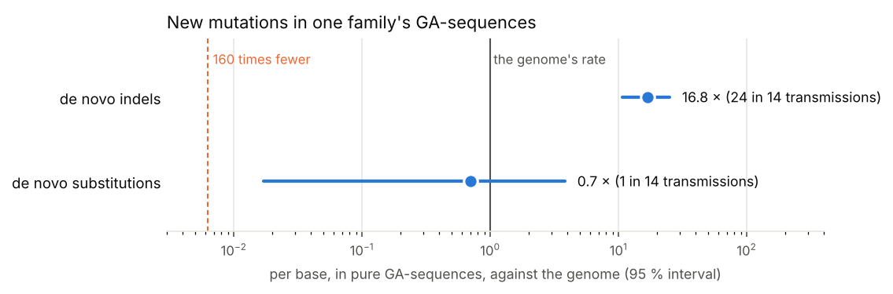
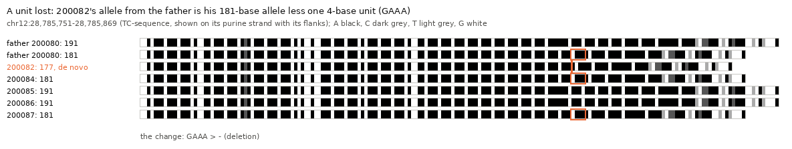
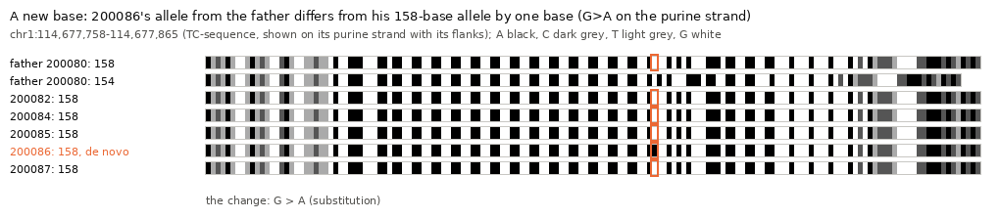
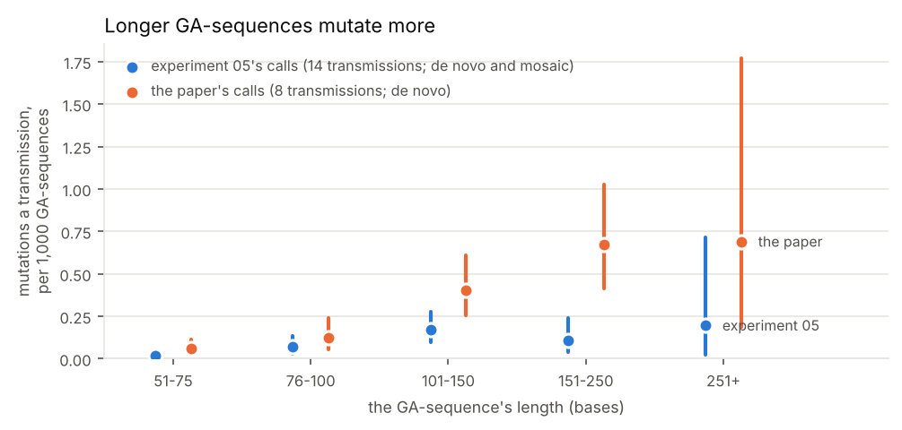
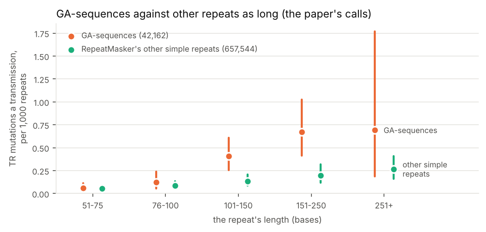

# 05. New mutations in pure GA-sequences, in a four-generation family

**Question.** [Experiment 04](../04-ga-sequences/) found that pure
GA-sequences carry 19 to 28 times the genome's insertions and deletions, and
that their substitutions are mostly transitions, which copy a neighbouring
unit of the sequence the more often the commoner the variant: 63 % of
gnomAD's singleton transitions, 84 % of its common ones, where chance gives
59 %. But a polymorphism is a mutation that survived. Do new mutations
already look like that? And what do they say of Albrecht-Buehler's "many
times fewer point mutations" (160 times, before his correction)?

Published de novo mutations hardly reach GA-sequences. Of the 28,725
autosomal de novo mutations of the CEPH three-generation families (Sasani et
al. 2019, from short reads), 5 fall inside, where 40 would at the genome's
density, while their 400-base flanks get 297, where 285 would: the reads, or
the call set's filters, leave GA-sequences out. So here they are found anew,
in the long reads of a four-generation family, CEPH 1463 (the
[Platinum Pedigree](https://github.com/Platinum-Pedigree-Consortium/Platinum-Pedigree-Datasets),
[Porubsky et al. 2025](https://doi.org/10.1038/s41586-025-08922-2)), whose
reads span GA-sequences whole. The family's paper lists its own de novo
mutations (its Supplementary Table 10), with tandem repeats called by a tool
made for them; [they are set beside these](#the-familys-own-calls).

**Answers.**

1. **New insertions and deletions hit GA-sequences 80 to 110 times as often
   as the genome, a base.** Of the 440 new tandem-repeat (TR) mutations that
   the family's paper calls in eight G3 children and that pass its filters
   on the autosomes, 67 are in GA-sequences: 15 % of them, in 0.14 % of the
   bases. That is 8.4 a transmission, where the paper's genome-wide rate of
   insertions and deletions gives 0.10: 82 times (95 % interval 64 to 104),
   or 108 times (84 to 138) the density of the same calls over all of the
   autosomes. This experiment's own calls found 16.8 times (10.8 to 25): of
   the paper's 40 in the five children both call, they had 2, the joint
   calls they start from genotyping most of the others with too little
   confidence, or at another size. The paper's ratios are well above
   experiment 04's for polymorphisms (19 to 28 times), which count each
   variant once, however often it arose.
2. **They add or remove whole units of the repeat.** Of the paper's 67, 38
   change the repeat by 4 bases (25 lose 4, 13 gain 4), 57 by a whole number
   of one of the locus's units of 2 bases or more, and 39 by a single unit.
   Losses outnumber gains, 45 to 22, and 49 of the 64 whose parent can be
   told arose in the father (77 %). This experiment's own calls agree: of 29
   simple insertions and deletions, 28 are copies of the unit beside them,
   mostly a single 4-base unit (16 lost, 8 gained); losses outnumber gains,
   19 to 10, and 24 of 31 arose in the father.
3. **New substitutions are consistent with the genome's rate, and not 160
   times fewer.** One in 14 transmissions, where the genome's rate gives
   1.46: 0.7 times (95 % interval 0.017 to 3.8). At 160 times fewer, one
   would be seen with a probability of 0.009; ten times fewer can't be ruled
   out (0.14). That one is a transition (G>A on the purine strand) that
   makes its 6 bases a 6-mer found elsewhere in the allele: it copies its
   neighbouring unit, GGAA. Two more, less sure (a parent's mosaic, and one
   whose other allele isn't seen), are transitions too, and one of them
   copies. The paper's 603 new germline substitutions on the autosomes, in
   ten children, put none in GA-sequences, where their contexts would put
   0.55: none is the likeliest count both at the genome's rate (P = 0.58)
   and at 160 times fewer (0.997), so they can't tell the two apart.
4. **Longer GA-sequences mutate more.** In the paper's calls, from 0.062
   mutations per 1,000 GA-sequences a transmission at 51 to 75 bases to 0.67
   at 151 to 250: eleven times. This experiment's own calls rise too, less
   steadily, at about a third of the rate. Alu tails carry 31 of the paper's 67
   (46 %), where 37 % of GA-sequences are Alu tails (p = 0.13), and 42 %
   would be with each GA-sequence weighted by its length's rate (p = 0.54).
5. **Short GA-sequences mutate about as often as other repeats as long, long
   ones about three times as often.** In the paper's calls, GA-sequences of
   51 to 100 bases have 0.06 to 0.12 TR mutations per 1,000 a transmission,
   RepeatMasker's other simple repeats as long 0.06 to 0.09, and pure runs
   of A and C of 51 to 75 bases 0.07, though pure runs of A and T as short
   have 0.26. From 101 bases on, GA-sequences have 0.41 to 0.69, the other
   simple repeats 0.14 to 0.27. But RepeatMasker's simple repeats need not
   be pure, pure runs of A and C are seldom so long, and those of A and T
   so long have almost none, for reasons the table doesn't give.
   [Experiment 06](../06-repeat-mutability/) asks it locus by locus, in the
   catalogue TRGT genotyped: matched for length, unit and purity,
   GA-sequences mutate as other repeats do, and they are half of the
   genome's long, pure repeats.

**What it means.** New mutations in GA-sequences are mostly a unit gained
or lost, as in microsatellites, more often the longer the sequence, and so
often that GA-sequences, 0.14 % of the autosomes, take 15 % of a child's new
tandem-repeat mutations. New substitutions are rare there, as anywhere, and
not the 160 times rarer of the first count, though neither call set has
enough to measure their rate. Whether new substitutions copy their
neighbours as often as the ones that spread do (experiment 04) one family
can't say: at the genome's rate a transmission gives 0.1, so some hundred
would take about a thousand long-read trios. And a call set made for
substitutions and short indels misses most of them, for its genotypes of
long repeats are uncertain; a caller made for tandem repeats, as the
paper's TRGT is, finds them.



## How it was done

The family's public data (AWS Open Data, `s3://platinum-pedigree-data`,
GRCh38): the HiFi joint calls of its 22 open members (DeepVariant and
GLnexus), and each member's HiFi reads. 16 children have both parents among
them: 2 in G2, whose parents' DNA is from cell lines only (G1 is no longer
living), and 5 in G3 and 9 in G4, whose parents' DNA is from blood
([UW Medicine](https://newsroom.uw.edu/news-releases/4-generations-help-science-explore-genome-mutation-rate)).

The family's paper made its own calls, from more reads and with more tools,
including three G3 children whose data are not open: tandem-repeat (TR)
mutations with TRGT, in the eight G3 children, on GRCh38 (and T2T-CHM13);
substitutions and other indels in G2 and G3, on T2T-CHM13 (Supplementary
Table 10 of
[Porubsky et al. 2025](https://doi.org/10.1038/s41586-025-08922-2)).

| Script | What it does | Output |
|---|---|---|
| [`ped.py`](ped.py) | the family, its trios, and where its files are | |
| [`short_reads.py`](short_reads.py) | how many of the CEPH three-generation families' short-read de novo mutations fall in GA-sequences (lifted to GRCh38) | `results/short_reads.json` |
| [`call_dnms.py`](call_dnms.py) | candidates genome-wide: an allele in a child, in neither parent (no read of it, GQ ≥ 20, depth 10 to 2.5 times the median), in no one else but the child's siblings and descendants | `results/candidates.tsv.gz`, `results/candidates.json` |
| [`validate.py`](validate.py) | every candidate in a GA-sequence, and 150 elsewhere, read whole in the family's HiFi reads: each read that spans the repeat, between two anchors of 15 bases found once nearby, for the child, parents, siblings, children and grandparents | `results/read_alleles.json.gz` |
| [`alleles.py`](alleles.py) | each person's alleles from those reads (by length, a base either way joined, then by sequence), and the verdict: is the child's new allele in neither parent? | `results/validated.tsv` |
| [`analyse.py`](analyse.py) | classes, what each new allele is against the parental allele closest to it, rates, mutability by length | `results/dnms_ga.tsv`, `results/analysis.json` |
| [`paper_calls.py`](paper_calls.py) | the paper's de novo mutations in GA-sequences: TR mutations against the genome and against other repeats, by length, unit and parent; the five children both call, and which of `call_dnms.py`'s rules kept the paper's from its candidates; substitutions and indels lifted from T2T-CHM13 | `results/paper_calls.json`, `results/paper_ga_events.tsv` |
| [`figures.py`](figures.py) | the pictures | `figures/` |

A candidate is **de novo** when the child's new allele (5 reads or more) is
in neither parent (at most a read of it, of 8 or more), the child's other
allele is in a parent (or the new one was passed on), no sibling has it, and,
when the child has three children or more, one of them has it. It is
**mosaic in a parent** when a parent has a few reads of it (fewer than a
fifth of theirs). A one-base change in a run of one base is taken for a read
error, so such new alleles are missed. Fetched twice, the reads gave the same
alleles and verdicts.

## Results

### Candidates

3,185 candidate alleles in the 16 trios: 81 substitutions a trio (the
paper: 74.5 a transmission), and 118 insertions and deletions, most of them
not new. Of 150 candidate sites checked the same way outside GA-sequences
(162 carriers), 43 of the 54 substitution verdicts with enough reads are
confirmed (24 of 26 in G4), but only 14 of 101 insertion and deletion
verdicts: the rest are inherited alleles a parent was called without (73),
or have a few reads in a parent (14); 25 of them are one-base changes in
runs of one base, which the reads can't settle. 117 candidate alleles (107
sites) fall in GA-sequences.

### Verdicts in GA-sequences

| | G3 and G4 (14 trios) | G2 (2 trios) |
|---|---|---|
| de novo | 25 | 8 |
| de novo, other allele not seen | 4 | |
| mosaic in a parent | 13 | 12 |
| shared by siblings | 4 | |
| too few reads of it | 2 | |
| not passed on (to any of 5 children) | | 1 |
| not new, or unclear | 30 | 18 |

The rates use G3 and G4 only: G1's DNA is from cell lines, where repeats can
drift in culture, and 12 of G2's 20 new alleles have a few reads in a parent
(G1). In G3 and G4, no new allele that could be tested for transmission
failed: NA12879's three were each passed on to two or three of her five
children.

| Per base, against the genome's rate (the paper's, per transmission) | GA-sequences | expected at the genome's rate | ratio (95 %) |
|---|---|---|---|
| insertions and deletions (7.4 + 65.3) | 24 | 1.43 | 16.8 (10.8 to 25.0) |
| substitutions (74.5) | 1 | 1.46 | 0.7 (0.017 to 3.8) |

### What the new alleles are

Each new allele against the parental allele closest to it, read as one
change (38 events of G3 and G4, de novo and mosaic):

| | |
|---|---|
| deletions | 19 (one unit of 4 bases: 16) |
| insertions | 10 (one unit of 4 bases: 8) |
| complex (both, or noisy reads) | 7 |
| substitutions | 2 |
| insertions and deletions that are copies of the unit beside them | 28 of 29 (de novo 18 of 19, mosaic 10 of 10) |
| arisen in the father / the mother / can't tell | 24 / 7 / 7 |
| in an Alu tail / simple repeat / low complexity / other | 18 / 15 / 3 / 2 |

The units: GAAA 4, TTTC 3, TCTT 3, TTCT 3, AAGA, CTTT, GGAA, AAAG and CCTT 2
each, TCCT and AGGA 1 each (read on the + strand); two 3-base units, two
copies of an 8-base unit lost at once, and one 24-base deletion that copies
nothing.

[figures/family_unit_deletion.png](figures/family_unit_deletion.png): a
unit lost. The father's 181-base allele went to three of the five children
with reads; in one of them it is one GAAA shorter.



[figures/family_substitution.png](figures/family_substitution.png): the de
novo substitution. The father's 158-base allele went to all five children
with reads; in one of them, one G is an A (on the purine strand), and the
run of GGAA units next to it is one unit longer.



### By length

| GA-sequence length | GA-sequences | mutations (G3, G4; de novo and mosaic) | per 1,000 a transmission (95 %) |
|---|---|---|---|
| 51-75 | 22,245 | 5 | 0.016 (0.005 to 0.037) |
| 76-100 | 8,210 | 8 | 0.070 (0.030 to 0.137) |
| 101-150 | 7,079 | 17 | 0.172 (0.100 to 0.275) |
| 151-250 | 3,904 | 6 | 0.110 (0.040 to 0.239) |
| 251 or more | 724 | 2 | 0.197 (0.024 to 0.713) |



### The family's own calls

Supplementary Table 10 of the paper lists 640 new TR mutations in the eight
G3 children on GRCh38: 609 on the autosomes, 440 of them passing all of its
filters. A TR mutation is counted in a GA-sequence when at least half of its
locus is in GA-sequences (`results/paper_ga_events.tsv` lists those in one
or touching one, each with its unit when one of the locus's motifs divides
the change, the origin of the GA-sequence it overlaps most, on the
autosomes, and, for those in one in the five children both call, experiment
05's verdict).

| The paper's TR mutations (passing, autosomes) | in a GA-sequence | touching one |
|---|---|---|
| mutations, of 440 | 67 (15.2 %) | 80 (18.2 %) |
| a transmission (8) | 8.4 | 10.0 |
| a base, against the same calls over the autosomes (95 %) | 108 (84 to 138) | 130 (103 to 161) |
| a base, against the paper's genome-wide rate of indels (95 %) | 82 (64 to 104) | 98 (78 to 122) |

With the calls that fail its filters, 102 of 609 are in a GA-sequence. By
child (passing, in a GA-sequence, of all the child's): NA12879 4 of 38,
NA12881 10 of 61, NA12882 10 of 54, NA12883 14 of 56, NA12884 7 of 48,
NA12885 8 of 61, NA12886 8 of 66, NA12887 6 of 56.

| What the 67 are | |
|---|---|
| a change of 4 bases | 38 (25 losses, 13 gains) |
| a whole number of one of the locus's units of 2 bases or more | 57 (a single unit: 39) |
| a number of a one-base unit only | 4 |
| losses / gains | 45 / 22 |
| arisen in the father / the mother / can't tell | 49 / 15 / 3 |
| passed on / not (in NA12879 and NA12886, whose children were sequenced) | 10 / 2 |
| in an Alu tail / simple repeat / low complexity / other | 31 / 28 / 6 / 2 |

A change's unit is the longest of the locus's motifs that divides it. The
table flags the mutations at 23 loci in GA-sequences as recurrent, and none
of them passes its filters; 16 of the 23 have a mutation in only one of the
eight children, so the flag draws on more than these calls.

**By length.** Per 1,000 GA-sequences a transmission (95 %): 51 to 75
bases, 0.062 (0.031 to 0.111; 11 mutations); 76 to 100, 0.122 (0.053 to
0.24; 8); 101 to 150, 0.406 (0.257 to 0.609; 23); 151 to 250, 0.672 (0.416
to 1.028; 21); 251 or more, 0.691 (0.188 to 1.768; 4).

**The two call sets.** In the five G3 children both call, the paper has 40
passing TR mutations in GA-sequences. Experiment 05 had 2 of them, both de
novo. Of the other 38, the HiFi joint calls give the child no new allele at
7. At the other 31 they give it an allele neither parent is called with,
though of the paper's size, against a parent's allele, at only 14, and each
breaks one of `call_dnms.py`'s rules, the first of them, in its order, a
genotype missing in the trio (17), a GQ under 20 (13), or another relative
called with it (1). The joint calls genotype these repeats with little
confidence, and `call_dnms.py` asks for confident genotypes. The other way,
of experiment 05's 9 de novo mutations in GA-sequences in those children, 2
are the paper's passing ones; 1, NA12885's loss of a TTCT at
chr19:6,630,951-6,631,052, is the paper's, flagged recurrent and found in
NA12887 too, whose data are not open; and 6 are not in the paper: a TTTC, a
TCTT and an AAGA lost and a GAAA gained (in NA12885 and NA12881), a complex
change of 69 bases that NA12879 passed on to 3 of her 5 children, and a
substitution whose other allele isn't seen. Experiment 05's 9 mosaic in a
parent are not in the paper.

**Against other repeats.** Each set leaves out repeats that overlap a
GA-sequence, and the mutations in GA-sequences:

| The paper's TR mutations (passing, autosomes) | repeats | bases | mutations | a megabase a transmission (95 %) |
|---|---|---|---|---|
| in GA-sequences | 42,162 | 3,869,600 | 67 | 2.16 (1.68 to 2.75) |
| in pure runs of A and C, or G and T | 9,447 | 546,090 | 6 | 1.37 (0.50 to 2.99) |
| in pure runs of A and T | 16,427 | 1,195,278 | 31 | 3.24 (2.20 to 4.60) |
| in pure runs of C and G | 103 | 6,803 | 0 | |
| in RepeatMasker's other simple repeats and low-complexity sequence | 657,544 | 35,543,279 | 180 | 0.63 (0.54 to 0.73) |
| over all of the autosomes | | 2,756,331,041 | 440 | 0.020 |

| Per 1,000 repeats a transmission (95 %) | GA-sequences | other simple repeats | pure A and C, G and T | pure A and T |
|---|---|---|---|---|
| 51-75 bases | 0.062 (0.031 to 0.111) | 0.056 (0.041 to 0.075) | 0.069 (0.022 to 0.16) | 0.259 (0.171 to 0.377) |
| 76-100 | 0.122 (0.053 to 0.24) | 0.087 (0.054 to 0.133) | 1 of 263 | 0.14 (0.017 to 0.51) |
| 101-150 | 0.406 (0.257 to 0.609) | 0.136 (0.085 to 0.206) | 0 of 50 | 0 of 903 |
| 151-250 | 0.672 (0.416 to 1.028) | 0.199 (0.116 to 0.319) | 0 of 14 | 0 of 513 |
| 251 or more | 0.691 (0.188 to 1.768) | 0.266 (0.162 to 0.411) | 0 of 5 | 2 of 220 |

Per base, GA-sequences mutate between pure runs of A and C and pure runs of
A and T, and 3.4 times as often as RepeatMasker's other simple repeats,
many of them shorter, and not all pure. Pure runs of A and T of 51 to 75
bases mutate four times as often as GA-sequences as long; of 101 to 250
bases they have none, where GA-sequences' rates would give 5.7, which the
table can't explain.



**Substitutions, other indels and structural variants.** The paper's
substitutions and other indels, in ten children (G2 and G3), are on
T2T-CHM13; lifted to GRCh38 with the T2T consortium's chain, 742 of its 772
substitutions go to one place, 715 of them on the autosomes, and 714 of
those where GRCh38's base is the paper's reference allele.

| The paper's, on the autosomes | | in GA-sequences | expected at their density (by context) | in the 400-base flanks (expected) |
|---|---|---|---|---|
| substitutions, germline | 603 | 0 | 0.85 (0.55) | 3 (6.0; p = 0.15) |
| substitutions, postzygotic | 111 | 0 | 0.16 (0.12) | 3 (1.1) |
| indels outside TRs, germline | 57 | 3 | 0.08 | 0 (0.6) |
| indels outside TRs, postzygotic | 13 | 0 | 0.02 | 1 (0.1) |

The three indels are NA12886's loss of 8 bases at chr2:229,387,501, the
gain of 4 at chr19:2,585,011 in NA12877, and a loss of 40 bases at
chr16:6,018,166 in NA12882, in the locus of the TR mutation of 24 bases
that both call sets have in that child, and perhaps the same deletion,
written on T2T-CHM13. Of the paper's 24 new structural variants on GRCh38,
3 are at GA-sequences, all TR deletions that TRGT called (of 53, 66 and 174
bases), and all among the TR mutations flagged recurrent.

## Caveats

- One family: 14 transmissions, and 1 new substitution. The numbers are
  small, and the longest GA-sequences have fewest reads that span them.
- The calls are strict: candidates from one caller, then confirmed in the
  reads. One-base changes in runs of one base are missed, and so are alleles
  the caller didn't propose or genotyped with little confidence, so the
  counts, and the ratio to the genome, are underestimates: in the children
  both call, the paper has 40 passing TR mutations in GA-sequences, of which
  these calls have 2. But a call rests on one technology's reads, and allows a
  read of the new allele in a parent; and the genome's rates are the
  family's paper's, from a more thorough pipeline.
- Mosaic events (a few reads in a parent) are counted apart from de novo
  ones, and shared ones (in two siblings or more, and in neither parent)
  left out: a parent's germline mosaic, or a parental allele missed.
- G2's new alleles may be G1's cell lines drifting; they are set apart.
- The parent a change arose in is the one whose allele is closest to the new
  one; when both parents' are as close, it is left open.
- The paper's TR mutations are those of the loci in TRGT's catalogue, which
  the table doesn't give; a repeat outside it can't have one. Its rates in
  other repeats assume that the catalogue, and TRGT's genotypes, cover them
  as they cover GA-sequences, which isn't checked here.
- A TR mutation counts in a GA-sequence when at least half of its locus is
  in GA-sequences: 67 do, and 13 more touch one.
- The ratios against the genome divide by the paper's genome-wide rates per
  transmission, as experiment 05's do; the ratio against the same TR calls
  over the autosomes needs no outside rate.

## Reproducing

```sh
# in a folder of its own: the joint calls (1.6 GB)
curl -O https://platinum-pedigree-data.s3.amazonaws.com/variants/small_variants/GRCh38/CEPH1463.GRCh38.deepvariant.glnexus.oa.vcf.gz{,.tbi}
python3 -I call_dnms.py CEPH1463.GRCh38.deepvariant.glnexus.oa.vcf.gz 2        # 4 min
CURL_CA_BUNDLE=... python3 -I validate.py REF_DIR 4 150    # 22 min, from the family's BAM files; run where their
                                                           # indexes (430 MB) can be saved
python3 -I alleles.py && python3 -I analyse.py
python3 -I short_reads.py ceph-dnm-manuscript/data GRCh37_to_GRCh38.chain.gz   # Sasani et al.'s files; Ensembl's chain

# the paper's calls: Supplementary Table 10 (41586_2025_8922_MOESM12_ESM.xlsx), from the article's page, and in the
# same folder the T2T consortium's chain from T2T-CHM13 to GRCh38 and UCSC's RepeatMasker table of GRCh38
curl -O https://s3-us-west-2.amazonaws.com/human-pangenomics/T2T/CHM13/assemblies/chain/v1_nflo/chm13v2-grch38.chain
curl -O https://hgdownload.soe.ucsc.edu/goldenPath/hg38/database/rmsk.txt.gz
python3 -I paper_calls.py 41586_2025_8922_MOESM12_ESM.xlsx chm13v2-grch38.chain REF_DIR \
    --vcf CEPH1463.GRCh38.deepvariant.glnexus.oa.vcf.gz --rmsk rmsk.txt.gz      # 4 min
python3 figures.py
```

REF_DIR is the Gpxil browser's GRCh38 gpxil files, as in experiment 04,
whose `results/` this one reads. Python 3.12 or later, with gpxiltools 0.7
or later, NumPy, SciPy, Matplotlib, Pillow, pysam, cyvcf2, pyliftover and
openpyxl. The paper's table isn't kept here, only what this experiment
drew from it.
