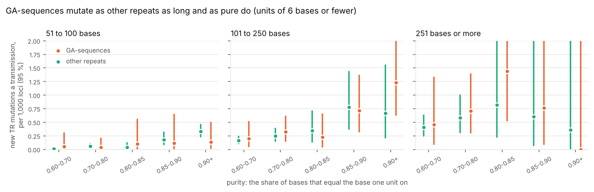

# 06. Are pure GA-sequences more mutable than other repeats?

**Question.** [Experiment 05](../05-ga-de-novo/) found, in the family's own
calls (Porubsky et al. 2025), that pure GA-sequences take 15 % of a child's
new tandem-repeat (TR) mutations in 0.14 % of the genome, and that from 101
bases on they mutate about three times as often as RepeatMasker's other
simple repeats as long. But a tandem repeat mutates more the longer it is,
the shorter its unit and the purer it is. Are GA-sequences more mutable
than other repeats of the same length, unit and purity, or are they simply
long, pure repeats? The catalogue of tandem repeats that TRGT genotyped in
the family answers it locus by locus.

**Answers.**

1. **Locus for locus, GA-sequences mutate as other repeats of their length,
   unit and purity do.** 27,784 of the catalogue's 7,270,921 autosomal loci
   lie in GA-sequences (at least half of each), and they have 67 of the 440
   new TR mutations: 0.30 per 1,000 loci a transmission. That is 5.7 times
   what the other loci of the same lengths have (95 % interval 4.4 to 7.3),
   and 5.1 times (3.9 to 6.4) with the same unit sizes too, but 0.92 times
   (0.72 to 1.17) once purity is matched as well. A Poisson model of length,
   unit size and purity gives them 1.26 times the rate of other loci (0.93
   to 1.72; p = 0.14). Within each length, the rate rises with purity for
   GA-sequences and for other repeats alike
   ([figures/purity.png](figures/purity.png)).
2. **They are half of the genome's long, pure repeats.** Of the 6,546 loci
   longer than 100 bases, with units of 6 bases or fewer and a purity of
   0.85 or more, 3,245 (50 %) are GA-sequences, and they have 23 of those
   loci's 41 new mutations. The share is 46 % to 51 % for purities from 0.8
   to 0.9, and 38 % to 56 % for loci longer than 75 to longer than 150
   bases.
3. **Repeats of A and T mutate more than the rest.** In the same model, with
   classes of composition in place of GA-sequences: loci of 90 % or more A
   and T (or C and G) 1.94 times the rate of mixed ones (1.43 to 2.64),
   GA-sequences 1.38 times (1.00 to 1.90; p = 0.049), other purine-rich
   loci, mostly short, 0.85 times (0.54 to 1.36), and those of A and C (or
   G and T) 0.69 times (0.41 to 1.18).
   ([figures/purity_by_class.png](figures/purity_by_class.png)).

**What it means.** GA-sequences are hotspots of new mutation because they
are long, pure repeats with short units, the commonest such repeats of the
genome, and not because a run of purines mutates faster than another repeat
as long and as pure: if there is an excess, it is small (1.26 to 1.38 times,
the intervals reaching 1.7 to 1.9), where repeats of A and T have twice. Experiment 05's "three times RepeatMasker's
other simple repeats" was a difference of purity. Where so many long, pure
repeats come from, experiment 04 has: the poly(A) tails of Alu elements,
which turn into repeats of A and G as they age.



## How it was done

The catalogue is Platinum TRs v1.0 (Dashnow, [Zenodo 13178746](https://doi.org/10.5281/zenodo.13178746),
CC BY 4.0), whose GRCh38 TRGT definitions the family's paper genotyped:
every one of the 581 loci of its new TR mutations is in it. Each of its
loci on the autosomes was measured on the Gpxil browser's GRCh38 gpxil
files, its bases read from the reference plane:

- **length**, and the size of its **unit**: the shortest of its motifs;
- **purity**: the share of its bases that equal the base one unit on, for
  the best of its motifs' sizes: 1 for a perfect repeat, about a quarter for
  random sequence (a locus is often several motifs merged; their bases
  within 50 of each other are one locus);
- **class**: a GA-sequence when at least half of it lies in pure GA- or
  TC-sequences (experiment 04); otherwise purine-rich when 90 % or more of
  its bases are A and G (or C and T), AT- or CG-rich, AC- or GT-rich, or
  other;
- its **new mutations**: the paper's TR mutations in the eight G3 children
  that pass its filters (Supplementary Table 10), 440 on the autosomes.

The loci are then counted by length (17 bins), unit (8), purity (9) and
class, and the statistics use only those counts (`results/strata.tsv.gz`):
GA-sequences' mutations against those the other loci of their strata would
give them (indirect standardisation), and Poisson models with the same
terms, the same likelihood as one locus at a time.

| Script | What it does | Output |
|---|---|---|
| [`mutability.py`](mutability.py) | every locus measured, counted in strata, and the statistics | `results/strata.tsv.gz`, `results/mutability.json` |
| [`figures.py`](figures.py) | the picture | `figures/purity.png` |
| [`figures_by_class.py`](figures_by_class.py) | the research article's Fig 1: the rate by purity for each class of composition, and the class terms of the Poisson model, at PLOS's size (7.5 inches, 300 dpi) | `figures/purity_by_class.png`, `figures/purity_by_class.tif` |

## Results

| The catalogue's autosomal loci | loci | bases | new TR mutations | per 1,000 loci a transmission |
|---|---|---|---|---|
| in GA-sequences | 27,784 | 4,111,260 | 67 | 0.30 |
| purine-rich, not GA-sequences | 1,453,877 | 26,334,426 | 29 | 0.0025 |
| AT- or CG-rich | 950,389 | 20,393,194 | 68 | 0.0089 |
| AC- or GT-rich | 642,727 | 12,506,293 | 20 | 0.0039 |
| other | 4,196,144 | 184,069,319 | 256 | 0.0076 |

| GA-sequences against the other loci of their strata | observed | expected | ratio (95 %) |
|---|---|---|---|
| matched for length | 67 | 11.7 | 5.72 (4.43 to 7.26) |
| for length and unit | 67 | 13.3 | 5.05 (3.91 to 6.41) |
| for length, unit and purity (27,639 of the 27,784 loci, in strata with other loci) | 67 | 72.5 | 0.92 (0.72 to 1.17) |

| Long, pure repeats with units of 6 bases or fewer | loci | GA-sequences | their share | new mutations | GA-sequences' |
|---|---|---|---|---|---|
| longer than 100 bases, purity 0.85 or more | 6,546 | 3,245 | 50 % | 41 | 23 |
| longer than 100, purity 0.8 or more | 11,903 | 5,440 | 46 % | 61 | 32 |
| longer than 100, purity 0.9 or more | 2,636 | 1,348 | 51 % | 18 | 12 |
| longer than 75, purity 0.85 or more | 11,578 | 4,424 | 38 % | 58 | 24 |
| longer than 150, purity 0.85 or more | 3,184 | 1,770 | 56 % | 20 | 11 |

## Caveats

- 440 new mutations in eight transmissions: the classes with few of them
  have wide intervals, and the purest and longest strata have few loci.
- A TR mutation is counted only at a locus of the catalogue that TRGT
  genotyped in the child and both parents; the catalogue, and the paper's
  filters, are taken as they are.
- Purity is measured on the reference's sequence, not on each person's
  alleles, and a locus of several motifs merged is scored by its best
  motif's size.
- The statistics stratify by bins; the standardised ratio matched for
  purity leaves out 145 GA-sequence loci in strata with no other loci.

## Reproducing

```sh
# in a folder of its own: the catalogue (147 MB) and the paper's Supplementary Table 10
curl -L -o human_GRCh38_no_alt_analysis_set.platinumTRs-v1.0.trgt.bed.gz \
    "https://zenodo.org/api/records/13178746/files/human_GRCh38_no_alt_analysis_set.platinumTRs-v1.0.trgt.bed.gz/content"
python3 -I mutability.py human_GRCh38_no_alt_analysis_set.platinumTRs-v1.0.trgt.bed.gz \
    41586_2025_8922_MOESM12_ESM.xlsx REF_DIR      # 7 min
python3 figures.py
```

REF_DIR is the Gpxil browser's GRCh38 gpxil files, as in experiments 04 and
05, whose code and `results/` this one reads. Python 3.12 or later, with
gpxiltools 0.7 or later, NumPy, pandas, SciPy, statsmodels, Matplotlib and
openpyxl.
