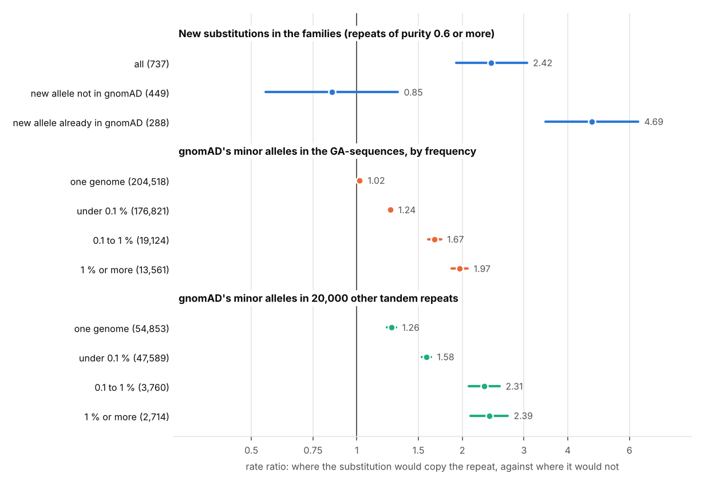

# 07. Do new mutations copy a repeat's own units?

**Question.** [Experiment 04](../04-ga-sequences/) found that the
substitutions of pure GA-sequences, in HG002 and in gnomAD, mostly turn a
stretch of the sequence into one it already has: they copy a neighbouring
unit, and the commoner the variant, the more often. If that is how repeats
mutate, it should show in new mutations, before selection, drift or gene
conversion have had time to act. [Experiment 05](../05-ga-de-novo/) had one
new substitution in a GA-sequence to look at. Here the question is put to
all the new substitutions of two sets of families, in every tandem repeat of
the Platinum TRs catalogue, and then to gnomAD's singletons.

**Answers.**

1. **At first sight, new substitutions copy.** The new substitutions come
   from the CEPH three-generation families (Sasani et al. 2019, short reads)
   and the Platinum Pedigree (Porubsky et al. 2025, long reads). 737 fall in
   tandem repeats of purity 0.6 or more. Of these, 158 make a 6-base word
   that the repeat already holds elsewhere. The rates of their trinucleotide
   contexts predict 95.7 (1.65 times; z = 7.9), and their 5-base contexts
   98.2.
   - **With the context held fixed, the effect holds.** Take the same 6-base
     window and new base, in loci of the same purity, length and unit size.
     The substitution is 2.4 times as frequent where it would copy as where it
     would not (rate ratio 2.42, 95 % interval 1.92 to 3.06). This holds with
     finer strata of locus (2.46) and without low-complexity regions (2.53). It
     holds outside clusters of new mutations, at allele balances of 0.45 or
     more, and in both of Sasani et al.'s generations.
   - **Where it does not show.** No excess shows in loci of fewer than three
     units (1.09; 0.65 to 1.82).
   - **Interruptions are put right.** New substitutions move toward the repeat's
     consensus unit 1.70 times as often as expected, and 4.5 to 6.7 times in
     the purest loci.
2. **But the new substitutions that copy are mostly alleles already in the
   population.** In gnomAD v4.1's 76,215 genomes:

   | New substitutions | Already in gnomAD | Share |
   |---|---|---|
   | in repeats, copying | 129 of 158 | 82 % |
   | in repeats, not copying | 159 of 579 | 27 % |
   | random sample outside repeats | 919 of 3,000 | 31 % |

   57 of the 129 are at sites that fail gnomAD's filters. The 449 whose
   alleles gnomAD lacks show no excess: 29 copy where their contexts predict
   38.8 (0.75 times). At a fixed context the rate ratio is 0.85 (0.55
   to 1.31), against 4.69 (3.45 to 6.36) for the 288 already there.
   - **The most reliable calls look the same.** These are Sasani et al.'s
     second generation (all 103 of the CEPH 1463 family's are among the
     Platinum Pedigree's calls) and the Platinum Pedigree's own. Their
     copying substitutions are mostly in gnomAD too: 11 of 13, and 7 of 10.
     The non-copying ones are in gnomAD at 19 of 76 and 8 of 27. The
     copying alleles are mostly rare there (allele counts of 1 to 96, with
     two at 2.5 and 3.8 %).
3. **gnomAD's singletons copy little.** A singleton, an allele seen in one
   genome, is the nearest a population comes to a new mutation. At a fixed
   context, far below the 2.4 of the families' new substitutions:

   | gnomAD singletons (minor alleles) | Count | Rate ratio (95 %) |
   |---|---|---|
   | pure GA-sequences | 204,518 | 1.02 (1.01 to 1.03) |
   | 20,000 other tandem repeats (purity 0.6 or more) | 54,853 | 1.26 (1.22 to 1.29) |

   - **The ratio rises with the allele's frequency** in both sets, to 1.97 and 2.39 for
     alleles of 1 % or more ([figures/copying.png](figures/copying.png)).

**What it means.** The strong copying belongs to particular alleles, those
seen more than once:

- alleles that recur or rise in frequency;
- alleles called at sites where calling goes wrong.

New mutations at large copy little. Where gnomAD has not seen the allele,
the families' new substitutions show no excess (0.85; 0.55 to 1.31), an
interval that cannot rule out the small excess of gnomAD's singletons
(1.02 to 1.26 times what their context predicts).

The substitutions that do copy are about three times as likely as the others
to be alleles gnomAD already has (82 % against 27 %). For the most reliable
calls, rare alleles already in gnomAD point to sites that mutate the same way
again and again. For the rest they could equally be inherited variants that
a parent's genotype missed, or errors; these data cannot tell which.

So experiment 04's pattern is mostly a pattern of alleles that have recurred
or spread. If repeats do mutate by copying their own units, it happens at a
few sites that do so again and again, not across their new substitutions at
large. A test against context alone, which the de novo data first seemed to
pass at z = 7.9, needs these controls before it can be read as mechanism.



## How it was done

| Script | What it does | Output |
|---|---|---|
| [`new_mutations.py`](new_mutations.py) | the new substitutions placed in the catalogue's loci; each one's copying, base one and two units away, move toward or away from the consensus, against the rates of its trinucleotide and 5-base contexts, within its own locus; two controls of words from other loci | `results/new_mutations.json`, `results/new_mutations.tsv.gz` |
| [`matched_context.py`](matched_context.py) | the same 6-base window and new base across the catalogue's loci: where it would copy and where not, Mantel-Haenszel | `results/matched_context.json` |
| [`in_gnomad.py`](in_gnomad.py) | each new substitution's place read in gnomAD, and the tests split by whether the allele is there | `results/in_gnomad.json`, `results/in_gnomad.tsv.gz` |
| [`gnomad_tr.py`](gnomad_tr.py) | gnomAD's records for 20,000 random tandem repeats other than GA-sequences (purity 0.6 or more, 20 bases or more) | a local copy of the records |
| [`population.py`](population.py) | the within-locus and fixed-context tests on gnomAD's minor alleles, by allele count, in the GA-sequences (experiment 04's records) and in those 20,000 repeats | `results/population.json` |
| [`figures.py`](figures.py) | the picture | `figures/copying.png` |

- **New substitutions.** Sasani et al.'s second-generation, third-generation and post-PGCS
  substitutions are lifted from GRCh37, and the Platinum Pedigree's from
  T2T-CHM13 (both on the autosomes). Each must be placed in a catalogue
  locus with its 6-base window inside it. The CEPH 1463 family is in both
  sets, so the 45 substitutions both call are counted once, as Sasani et al.'s.
- **A copy.** A substitution at base j copies when bases j − 2 to j + 3,
  after the change, occur elsewhere in the locus. The **period** of a locus
  is gpxiltools' period finder's, searched up to 12 bases, or up to the
  locus's first motif's length when that is longer (at most 100). Its
  **consensus** is the commonest base at each place in the period, for loci
  of three units or more.
- **Within the locus.** Under the null, a new substitution falls on each
  base of its locus, and becomes each other base, at the rate of its
  context. The rates come from Sasani et al.'s 26,727 germline
  substitutions against the autosomes' trinucleotides. For 5-base contexts,
  the trinucleotide rate is scaled by the 5-mer's observed over expected
  count, shrunk toward 1 by 10 pseudo-mutations. Observed counts are set
  against the sum of the expected shares, and a normal approximation to the
  Poisson-binomial gives z.
- **Controls of other loci.** Five loci are drawn for each mutated locus,
  with the same purity bin (0.6, 0.8, 0.9) and length within 20 % (50 % when
  none is that close):
  - another repeat of the same unit size (1 to 6 bases, or 7 and more; any
    motif);
  - a locus of the same first motif, up to rotation and strand, read on the
    same strand.
- **At a fixed context.** Every place of a mutation's 6-base window in every
  catalogue locus is an opportunity for the same substitution. An
  opportunity copies or not. A stratum is the window, the new base and the
  locus's kind (purity, length and unit, and in the finest strata
  experiment 06's 9 purity and 17 length bins and its composition class).
  Conditioned on a stratum's mutations, the copying ones are binomial. The
  Mantel-Haenszel rate ratio has Greenland and Robins' variance.
- **gnomAD.** gnomAD v4.1 genomes' sites VCFs are read over the web, a place at a
  time.
  - **De novo sites.** Every record at the place, whatever its FILTER.
  - **For population.py.** PASS records, biallelic positions only. The tests
    by allele count take the minor alleles (AF under 0.5); the within-locus
    tests of singletons take them all, 16 and 1 more, at sites called in one
    genome.
  - **Background spectrum.** The singletons of experiment 04's 10,000 random
    100-base windows.

## Results

**Within the locus, by purity and unit size** (trinucleotide contexts; each
substitution counted once):

| Loci | New substitutions | Copy: observed | expected | ratio (z) | Toward the consensus: observed | expected | ratio (z) |
|---|---|---|---|---|---|---|---|
| purity under 0.6, units 1 to 6 | 1,064 | 204 | 173.9 | 1.17 (+2.8) | 237 | 220.7 | 1.07 (+1.3) |
| purity under 0.6, units 7+ | 99 | 19 | 16.6 | 1.14 (+0.8) | 19 | 15.6 | 1.22 (+1.0) |
| 0.6 to 0.8, units 1 to 6 | 205 | 49 | 39.6 | 1.24 (+1.9) | 38 | 26.4 | 1.44 (+2.5) |
| 0.6 to 0.8, units 7+ | 83 | 26 | 15.9 | 1.63 (+3.2) | 6 | 6.9 | 0.87 (−0.4) |
| 0.8 to 0.9, units 1 to 6 | 67 | 18 | 11.2 | 1.61 (+2.4) | 11 | 5.2 | 2.11 (+2.8) |
| 0.8 to 0.9, units 7+ | 87 | 23 | 14.7 | 1.57 (+2.7) | 6 | 4.5 | 1.34 (+0.8) |
| 0.9 or more, units 1 to 6 | 175 | 13 | 3.7 | 3.53 (+5.3) | 10 | 2.2 | 4.47 (+5.7) |
| 0.9 or more, units 7+ | 120 | 29 | 10.5 | 2.76 (+6.5) | 8 | 1.2 | 6.72 (+6.6) |
| **0.6 or more** | **737** | **158** | **95.7** | **1.65 (+7.9)** | **79** | **46.4** | **1.70 (+5.3)** |

(The consensus needs three units; 424 of the 737 have it.)

**Purity 0.6 or more, the other tests:**

| New substitutions that | Mutations | Observed | Expected | Ratio (z) |
|---|---|---|---|---|
| copy their own locus, 5-base contexts | 737 | 158 | 98.2 | 1.61 (+7.5) |
| copy another repeat of their unit size | 737 | 24.7 | 25.6 | 0.96 (−0.2) |
| copy another locus of their motif | 539 | 59 | 44.8 | 1.32 (+2.4) |
| take the base one unit away | 737 | 147 | 84.3 | 1.74 (+7.8) |
| take the base two units away | 737 | 125 | 80.9 | 1.54 (+5.7) |
| move away from the consensus, and copy | 252 | 62 | 39.6 | 1.57 (+4.4) |
| move away from the consensus, and copy a locus of their motif | 177 | 18 | 17.1 | 1.06 (+0.3) |

The controls are averaged over five loci each. In the 539 with
same-motif controls, the locus's own excess is 1.44 times its expectation
and the same-motif loci's 1.32 times. The difference is not significant
(z = 1.3). A substitution that puts an interruption right makes the pure
word, which every locus of the motif holds.

**At a fixed context, purity 0.6 or more** (strata of purity, length and
unit):

| New substitutions | Mutations | Copying | Expected | Rate ratio (95 %) |
|---|---|---|---|---|
| all | 737 | 158 | 100.8 | 2.42 (1.92 to 3.06) |
| all, finest strata | 737 | 158 | 115.7 | 2.46 (1.84 to 3.28) |
| all, outside low-complexity regions | 679 | 135 | 80.7 | 2.53 (1.99 to 3.23) |
| in loci of fewer than three units | 313 | 19 | 17.8 | 1.09 (0.65 to 1.82) |
| Sasani et al.'s second generation | 89 | 13 | 8.4 | 2.17 (1.02 to 4.59) |
| new allele not in gnomAD | 449 | 29 | 32.6 | 0.85 (0.55 to 1.31) |
| new allele in gnomAD | 288 | 129 | 68.3 | 4.69 (3.45 to 6.36) |
| in gnomAD, PASS | 198 | 72 | 42.5 | 3.29 (2.26 to 4.80) |
| in gnomAD, failing its filters | 90 | 57 | 25.7 | 9.64 (5.43 to 17.12) |
| purity under 0.6, new allele not in gnomAD | 703 | 85 | 84.9 | 1.00 (0.77 to 1.30) |

**gnomAD's minor alleles, at a fixed context:**

| Allele count | GA-sequences: alleles | rate ratio (95 %) | 20,000 other repeats: alleles | rate ratio (95 %) |
|---|---|---|---|---|
| one genome | 204,518 | 1.02 (1.01 to 1.03) | 54,853 | 1.26 (1.22 to 1.29) |
| more, under 0.1 % | 176,821 | 1.24 (1.23 to 1.26) | 47,589 | 1.58 (1.53 to 1.63) |
| 0.1 to 1 % | 19,124 | 1.67 (1.60 to 1.74) | 3,760 | 2.31 (2.08 to 2.56) |
| 1 % or more | 13,561 | 1.97 (1.86 to 2.07) | 2,714 | 2.39 (2.11 to 2.70) |

Within the locus, against the singletons' trinucleotide rates, gnomAD's
singletons copy 1.09 times as often as expected in GA-sequences, and 1.11
times in the other repeats. They move toward the consensus 0.97 and 1.04
times as often.

## Caveats

- **Most of the new substitutions are Sasani et al.'s third generation**,
  622 of the 737. They had no further generation to confirm them. In the
  CEPH 1463 family, the Platinum Pedigree's calls hold all 103 of their
  second-generation substitutions, but only 452 of the 672 of the third
  generation. Of the family's substitutions of both generations in the
  catalogue's loci, at all purities, they hold 8 of 14 that copy and 37 of
  51 that do not.
- **"Already in gnomAD" can mean three things.** The site may mutate the same
  way again and again, the variant may be inherited and missed in a parent,
  or the call may be wrong. For the most reliable calls the first is likely;
  for the others these data cannot tell.
- **The singletons are short-read calls.** They include errors, and the two
  sets of repeats differ: GA-sequences are pure purine runs, so only
  transitions can copy in them.
- **The definitions are fixed choices.** Copies are 6-base words. The period
  is capped at 100 bases, and the consensus is the commonest base at each
  place.
- **Each stratum stands alone.** The fixed-context test compares a window in
  different loci of one kind. It assumes that nothing but copying separates
  a stratum's copying places from its other places.

## Reproducing

```sh
python3 -I new_mutations.py REF_DIR FEATURES CATALOG DNM_DIR GRCh37_to_GRCh38.chain.gz \
    41586_2025_8922_MOESM12_ESM.xlsx chm13v2-grch38.chain                       # 10 min
CURL_CA_BUNDLE=... python3 -I in_gnomad.py DNM_DIR GRCh37_to_GRCh38.chain.gz dnm_records.tsv.gz   # 5 min
python3 -I matched_context.py REF_DIR FEATURES LCR-hs38.bed.gz                  # 25 min
CURL_CA_BUNDLE=... python3 -I gnomad_tr.py FEATURES tr_records.tsv.gz           # 20 min
python3 -I population.py REF_DIR gnomad_records.tsv.gz tr_records.tsv.gz FEATURES   # 15 min
python3 figures.py
```

- **REF_DIR** is the Gpxil browser's GRCh38 gpxil files.
- **FEATURES** is experiment 06's per-locus measures
  (`mutability.py ... --features FILE`).
- **CATALOG** is the Platinum TRs catalogue v1.0.
- **DNM_DIR** is the `data/` of
  [ceph-dnm-manuscript](https://github.com/quinlan-lab/ceph-dnm-manuscript)
  (MIT).
- **LCR-hs38.bed.gz** is from [lh3/varcmp](https://github.com/lh3/varcmp).
- **gnomad_records.tsv.gz** is experiment 04's local copy of its gnomAD
  records (`GNOMAD_RECORDS`).

The scripts that read gnomAD over the web leave its index files in the
current folder, so run them from a folder of their own. They also read
experiments 04 and 05's code. Python 3.12 or later, with gpxiltools 0.8,
NumPy, pandas, SciPy, pysam, pyliftover, openpyxl and Matplotlib.
