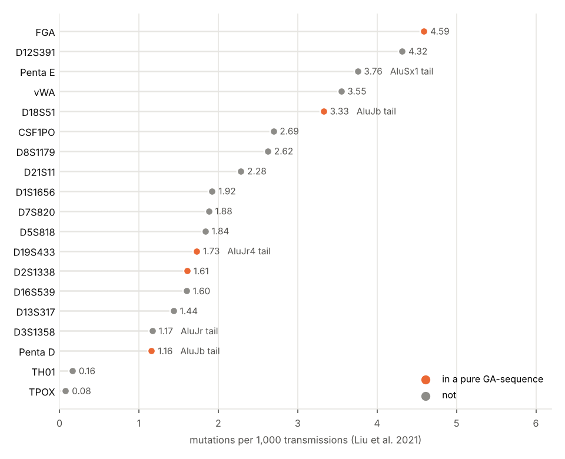

# 08. Which forensic STR markers are pure GA-sequences?

**Question.** Forensic laboratories type a few dozen short tandem repeats
(STRs), chosen for how many alleles they have. Experiment 06 found that
pure GA-sequences are half of the genome's long, pure repeats, and
experiment 04 that many begin as the poly(A) tails of Alu elements. Which
of the forensic markers are GA-sequences, where did they come from, and do
they mutate faster than the others?

**Answers.**

1. **Seven of 27 markers lie in pure GA-sequences.** Placed on GRCh38 and
   set against experiment 04's census (pure GA- or TC-sequences longer than
   50 bases): FGA (106 bases), SE33 (199), D18S51 (107), Penta D (86),
   D19S433 (73), D2S1338 (54) and D10S1248 (53). The census covers 0.14 %
   of the genome.
2. **Five begin at the 3′ end of an Alu.** Five markers' repeats start
   within 30 bases of an Alu's 3′ end, on the strand whose repeat is purine-rich:
   D18S51 (AluJb, 29 bases away), D19S433 (AluJr4, 1), Penta D (AluJb, 3),
   D3S1358 (AluJr, 0) and Penta E (AluSx1, 28). This is the rule experiment 04
   used for Alu tails. Two more lie within 100 bases of one: D17S1301
   (AluSx1, 46) and SE33 (AluSq2, 70). RepeatMasker's (CTTT)n at SE33 runs
   up to the AluSq2's 3′ end; its run of whole units starts 70 bases in.
3. **The GA-sequence markers do not mutate faster.** In Liu et al. 2021
   (28,313 paternity cases, 19 loci), the five GA-sequence markers among
   the 19 average 2.5 mutations per 1,000 transmissions and the other 14
   average 2.1 (Mann-Whitney p = 0.89). FGA is the most mutable of the 19,
   but D2S1338 and Penta D are among the least. Measured on the reference,
   neither the longest uninterrupted run of units (Spearman ρ = 0.20,
   p = 0.41) nor the array's length (ρ = 0.18, p = 0.47) ranks the 19 rates.

**What it means.** The census reaches into forensic genetics: a quarter of
the markers are pure GA-sequences, and five come from Alu tails, as
Arcot et al. (1995) found for microsatellites generally. The markers were
chosen for their many alleles, which long, pure repeats have. So it fits
experiment 06 that GA-sequence markers mutate no faster than the other
markers. Among repeats picked for being polymorphic, being a GA-sequence
adds nothing. One reference allele does not predict a marker's
mutation rate. Penta E's reference allele has 5 units, for example,
while lusSTR lists its alleles from 5 to 25.



## How it was done

| Script | What it does | Output |
|---|---|---|
| [`markers.py`](markers.py) | places the markers, finds each one's repeat, and sets it against the census, RepeatMasker and the rates | `results/markers.json`, `results/markers.tsv` |
| [`figures.py`](figures.py) | the picture | `figures/markers.png` |

- **The markers.** The autosomal STRs of the forensic kits come from
  [lusSTR](https://github.com/bioforensics/lusSTR) (v0.11, commit
  `0a5456bf`): its test alleles, each marker's longest with its flanks,
  and its repeat units. SE33, which lusSTR lacks, comes from GenBank
  [V00481](https://www.ncbi.nlm.nih.gov/nuccore/V00481) (bases 14 to 356)
  with the unit AAAG.
- **Placing them.** A 24-base window of a flank, 0 to 40 bases from either
  end of the allele, is found exactly once in the autosomes on either
  strand. The search reads the reference plane of the Gpxil browser's
  GRCh38 gpxil files and hashes every 24-base word. A marker whose window lands on another
  chromosome than its name's is left unplaced. Only D9S1122 was left
  unplaced: its test allele's one unique window fell on chromosome 16.
- **The repeat.** In the placed span, plus 20 bases each side, the repeat is the
  longest array of whole units of the marker's motif. Any rotation of the motif counts, on one strand, with
  gaps of up to a unit. The longest uninterrupted run of units (LUS) is
  counted too.
- **GA-sequence and origin.** A marker is a GA-sequence when its array
  overlaps one of experiment 04's census. It begins as an Alu tail when an
  Alu on its purine-rich strand ends (3′) within 30 bases of where the array
  starts on that strand, in UCSC's RepeatMasker annotation of hg38.
- **Mutation rates.** These are the trio rates of Liu et al. 2021 (Table 1), from Chinese Han
  parentage cases. Each is the mean of the paternal and maternal rates, under the
  paper's restricted model.

## Results

| Marker | GRCh38 | Unit | Array (bases) | LUS (units) | GA-sequence (bases; origin) | Alu at the start (bases away) | Rate (Liu 2021, per 1,000) |
|---|---|---|---|---|---|---|---|
| CSF1PO | chr5:150,076,321-150,076,397 | ATCT | 76 | 13 | | | 2.69 |
| D10S1248 | chr10:129,294,243-129,294,301 | GGAA | 58 | 13 | 53; simple repeat | | |
| D12S391 | chr12:12,297,013-12,297,066 | AGAT | 53 | 12 | | | 4.32 |
| D13S317 | chr13:82,148,024-82,148,068 | TATC | 44 | 11 | | | 1.44 |
| D16S539 | chr16:86,352,701-86,352,745 | GATA | 44 | 11 | | | 1.60 |
| D17S1301 | chr17:74,684,854-74,684,902 | AGAT | 48 | 12 | | (AluSx1, 46) | |
| D18S51 | chr18:63,281,666-63,281,743 | AGAA | 77 | 18 | 107; Alu tail | AluJb, 29 | 3.33 |
| D19S433 | chr19:29,926,224-29,926,299 | CCTT | 75 | 13 | 73; Alu tail | AluJr4, 1 | 1.73 |
| D1S1656 | chr1:230,769,616-230,769,683 | TCTA | 67 | 16 | | | 1.92 |
| D20S482 | chr20:4,525,691-4,525,753 | AGAT | 62 | 14 | | | |
| D21S11 | chr21:19,182,012-19,182,131 | TCTA | 119 | 12 | | | 2.28 |
| D22S1045 | chr22:37,140,286-37,140,342 | ATT | 56 | 14 | | | |
| D2S1338 | chr2:218,014,844-218,014,924 | GGAA | 80 | 13 | 54; simple repeat | | 1.61 |
| D2S441 | chr2:68,011,946-68,011,998 | TCTA | 52 | 12 | | | |
| D3S1358 | chr3:45,540,736-45,540,803 | TCTA | 67 | 14 | | AluJr, 0 | 1.17 |
| D4S2408 | chr4:31,302,791-31,302,834 | ATCT | 43 | 9 | | | |
| D5S818 | chr5:123,775,552-123,775,599 | ATCT | 47 | 11 | | | 1.84 |
| D6S1043 | chr6:91,740,222-91,740,287 | ATCT | 65 | 12 | | | |
| D7S820 | chr7:84,160,212-84,160,277 | TATC | 65 | 13 | | | 1.88 |
| D8S1179 | chr8:124,894,862-124,894,917 | TCTA | 55 | 11 | | | 2.62 |
| FGA | chr4:154,587,745-154,587,823 | AAAG | 78 | 14 | 106; simple repeat | | 4.59 |
| Penta D | chr21:43,636,188-43,636,272 | AAAGA | 84 | 13 | 86; Alu tail | AluJb, 3 | 1.16 |
| Penta E | chr15:96,831,011-96,831,039 | TCTTT | 28 | 5 | | AluSx1, 28 | 3.76 |
| SE33 | chr6:88,277,129-88,277,288 | AAAG | 159 | 16 | 199; simple repeat | (AluSq2, 70) | |
| TH01 | chr11:2,171,085-2,171,116 | AATG | 31 | 7 | | | 0.16 |
| TPOX | chr2:1,489,650-1,489,684 | AATG | 34 | 8 | | | 0.08 |
| vWA | chr12:5,983,966-5,984,020 | TAGA | 54 | 11 | | | 3.55 |

Coordinates are 0-based starts and ends, as in a BED file. Alus in
parentheses lie within 100 bases of the array's start but not within 30.

## Caveats

- One allele, the reference's, stands for each marker. A marker's
  mutation rate depends on the lengths of its alleles in the population,
  which the reference does not give.
- The rates come from one population and one laboratory network, and from the paper's
  restricted mutation model. Only 19 markers have rates, five of them
  GA-sequences, so the comparison has little power.
- A test allele's flanks place a marker only where a 24-base window of
  them is unique. D9S1122 could not be placed this way.
- "Alu tail" is a rule of distance on the annotation. An Alu whose tail has
  decayed beyond the array's start, as at SE33, falls outside it.

## Sources

- Liu Z, et al. Actual mutational research of 19 autosomal STRs based on
  restricted mutation model and big data. Hereditas (Beijing).
  2021;43(10):949-961. doi:[10.16288/j.yczz.21-197](https://doi.org/10.16288/j.yczz.21-197).
- lusSTR, Battelle National Biodefense Institute for DHS (BSD-style licence).
- Arcot SS, Wang Z, Weber JL, Deininger PL, Batzer MA. Alu repeats: a
  source for the genesis of primate microsatellites. Genomics.
  1995;29(1):136. doi:[10.1006/geno.1995.1224](https://doi.org/10.1006/geno.1995.1224).

## Reproducing

```sh
git clone https://github.com/bioforensics/lusSTR       # (commit 0a5456bf)
# GenBank V00481 as FASTA, and UCSC's hg38 rmsk.txt.gz, each in a folder of its own
python3 -I markers.py REF_DIR lusSTR V00481.fasta rmsk.txt.gz      # 30 min
python3 figures.py
```

REF_DIR is the Gpxil browser's GRCh38 gpxil files, as in experiments 04 to
07. The script also reads experiment 04's `results/`. Python 3.12 or later, with
gpxiltools 0.7 or later, NumPy, SciPy and Matplotlib.
