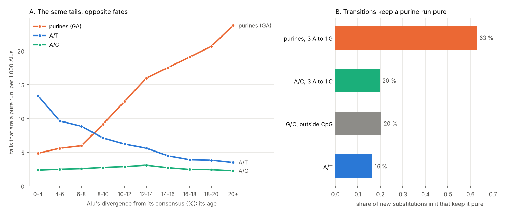

# 09. Why are the genome's long pure runs purines?

**Question.** A pure GA-sequence is a run of more than 50 bases drawn from
two letters, the purines A and G, on one strand. The four bases split into
two complementary pairs in two other ways: A/T against G/C, and A/C against
G/T. The genome is 59 % A and T, so long A/T runs ought to be the commonest.
Are they? Experiment 04 found that many GA-sequences began as the poly(A)
tails of Alu elements, and more often the older the Alu. Do the tails become
pure runs of the other alphabets too? If not, why purines?

**Answers.**

1. **Purine runs are the commonest, against the composition.** The
   autosomes hold 42,162 pure purine/pyrimidine runs of more than 50 bases
   (3.9 Mb), 16,679 A/T runs (1.2 Mb), 9,725 A/C runs (0.6 Mb) and 105 G/C
   runs. A first-order Markov model of the autosomes' sequence expects 1.7
   times as many A/T runs as purine runs (and far fewer than one of either);
   there are 2.5 times as many purine runs as A/T runs.
2. **Alu tails seed all three alphabets that hold A, but only purine runs
   come with age.** Alu tails start 37 % of the purine runs, 40 % of the A/T
   runs and 31 % of the A/C runs. Per 1,000 Alus, tails that are a pure
   purine run rise from 4.8 among the youngest (diverged less than 4 % from
   their consensus) to 23.8 among the oldest (20 % or more). Tails that are a
   pure A/T run fall from 13.4 to 3.5, and A/C runs stay at 2.2 to 3.1.
   Subfamilies give ages that don't depend on any copy's tail, and point the
   same way: across the 23 Alu subfamilies with 5,000 copies or more, the
   purine tail runs rise with the subfamily's median divergence (Spearman
   ρ = 0.63, p = 0.001) and the A/T runs fall (ρ = −0.90, p = 7 × 10⁻⁹);
   A/C runs fall a little (ρ = −0.41, p = 0.05). Within each of the 16
   largest subfamilies, the most diverged third of its copies has more
   purine tail runs than the least diverged third, and longer ones, in all
   16; more A/T runs in 5.
3. **In Alu tails, only purine runs grow.** Alu tails' purine runs
   lengthen with age, from a mean of 69 bases (median 59) among the youngest
   to 110 (median 89) among the oldest, and their commonest base falls from
   85 % to 61 %. Their A/T and A/C runs stay at 62 to 65 and 57 to 60 bases
   at every age. L1 tails show the shift in kind but not the growth: their
   A/T runs fall from 17.9 per 1,000 L1 pieces (diverged less than 5 %) to
   0.3 (30 % or more), while their purine runs stay at 1.2 to 2.6 and grow
   no longer (a mean of 112 bases among the youngest, 95 among the oldest);
   the few A/T runs left in the oldest L1 tails are the longer ones (87,
   against 61 among the youngest).
4. **Transitions keep a purine run pure.** A substitution keeps a run pure
   when its new base is in the run's alphabet: in a purine run, a transition
   (A↔G); in an A/T run, A↔T; in an A/C run, A↔C. Of the 27,557 new
   substitutions of the CEPH families and the Platinum Pedigree, 67.5 % are
   transitions: 65 % of those at A:T pairs, 58 % at C:G pairs outside CpG and
   91 % at CpG. So 63 % of new substitutions in a purine run like (AAAG)n
   keep it pure (61 % in one like (AAGG)n), against 16 % in an A/T run and
   20 to 21 % in an A/C run. A G/C run keeps 20 % outside CpG and 5 % at its
   CpGs. Base for base, a purine run is broken 0.5 to 0.6 times as often as
   an A/T run.
5. **Purine runs mutate as other repeats do; A/T runs, nearly twice as
   often.** The Platinum Pedigree's new tandem-repeat mutations, in catalogue
   loci at least half inside a run, against loci of the same length, motif
   size and purity (experiment 06's strata): purine runs 67 against 72.5
   expected (0.92; 0.72 to 1.17), A/T runs 31 against 16.5 (1.87; 1.27 to
   2.66), A/C runs 6 against 9.3 (0.65; 0.24 to 1.41). Experiment 06 found the
   same: 0.92 for GA-sequences, and twice the rate for AT-rich repeats as a
   class.

**What it means.** The poly(A) tails of retrotransposons seed pure runs in
every alphabet that holds A. Most substitutions are transitions, which keep a
purine run pure and break the other runs. That fits the purine runs being
the ones that become commoner, and in Alu tails longer, as the tails age:
Albrecht-Buehler's GA-sequences are the alphabet that the human spectrum of
mutation preserves. In the human genome, that offers a mutational
explanation for a pattern long known in eukaryotes: long oligopurine tracts
are far more common than base composition predicts, as Behe (1995) found in
every eukaryote he examined but not in prokaryotes, and Yagil (2004) found
them more over-represented than the other two-letter tracts in human
chromosomes, though in Drosophila A/C tracts lead; both proposed a
function. Other genomes, with their own spectra, are not tested here. The
spectrum doesn't explain everything: it breaks A/C runs at least as often as
A/T runs, yet Alu tails' A/C runs hold steady with age while their A/T runs
fall four-fold. The tails' sequence when they arrive, slippage, or
substitutions peculiar to poly(A) must shape those. Substitutions inside a run can't lengthen it
either: the growth must come from slippage, or from substitutions at its
edges. In HG002, substitutions beside pure runs extend them far more often
than the spectrum predicts (experiment 10), but new mutations there are too
few to tell how much of that is mutation.



## How it was done

| Script | What it does | Output |
|---|---|---|
| [`alphabets.py`](alphabets.py) | finds every pure run of more than 50 bases in each alphabet; its unit, origin, benchmark coverage and new TR mutations; the Markov expectation | `results/alphabets.json`, `results/runs.tsv.gz` |
| [`ages.py`](ages.py) | Alu and L1 tails that are pure runs, by divergence, subfamily and thirds within subfamilies; the runs' length and composition by age | `results/ages.json` |
| [`spectrum.py`](spectrum.py) | the spectrum of new substitutions, and the share that keeps a run of each alphabet pure | `results/spectrum.json` |
| [`figures.py`](figures.py) | the picture | `figures/alphabets.png` |

- **The runs.** gpxiltools' run finder reads the reference plane of the
  Gpxil browser's GRCh38 gpxil files and takes an alphabet as a set of
  letters; a base belongs when its 4-bit code lies inside the set's. The
  purine and A/C alphabets are read on both strands (a C/T run is a purine
  run of the other strand; a G/T run, an A/C run). Each run's period and
  purity come from gpxiltools' period finder (periods up to 12), its unit is
  its commonest word of that length in canonical form, and its strand is the
  one with more A than T (A/T runs) or more G than C (G/C runs).
- **Origins** extend experiment 04's rule for Alu tails to every element of
  the SINE, LINE, LTR, DNA and retroposon classes of UCSC's RepeatMasker
  annotation of hg38: one whose 3' end lies within 30 bases of the run's
  start, on the run's A-rich strand, makes the run its tail (the closest,
  when several do); otherwise the run takes the class whose annotation,
  summed, covers half of it or more. Experiment 04 looked for Alus alone and
  took the single annotation covering half a run, so the counts differ: here
  15,653 purine runs are Alu tails and 30.2 % simple repeats, there 15,698
  and 33.3 %. For ages,
  each tail run is given to its element, and each RepeatMasker row counts
  as an element; its milliDiv (divergence from its subfamily's consensus)
  measures its age.
- **The spectrum** is that of the new substitutions of the CEPH families
  (Sasani et al. 2019, lifted to GRCh38) and the Platinum Pedigree (Porubsky
  et al. 2025), read as experiment 07 reads them, each with its trinucleotide
  on the reference plane, with a pyrimidine in the middle. The CEPH 1463
  family is in both, so the 559 of the Platinum Pedigree's 714 that Sasani
  et al. also called count once, as theirs; it adds 155. The rate at C:G
  pairs outside CpG, per base, is 1.56 times that at A:T pairs. The share kept
  weighs the two pairs by a run's composition and by their rates per
  base.
- **The Markov model** is the autosomes' first-order chain of bases (their
  dinucleotide counts); the expected number of runs of 51 bases or more in an
  alphabet is the chance that a base outside it is followed by 51 inside it,
  times the bases.

## Results

### The runs

Autosomes; runs of more than 50 bases. All chromosomes hold 45,681 purine
runs, experiment 04's census of GA- and TC-sequences.

| Alphabet | Runs | Bases | Median length | 99th centile | Longest | Commonest units | Alu tail | Simple repeat | Low complexity | L1 tail |
|---|---|---|---|---|---|---|---|---|---|---|
| purine/pyrimidine | 42,162 | 3,869,600 | 73 | 282 | 1,303 | AAAG, AAGG, AAAA | 37.1 % | 30.2 % | 17.4 % | 3.2 % |
| A/T | 16,679 | 1,209,670 | 59 | 278 | 1,067 | AT, AAAT, AA | 40.1 % | 31.5 % | 0.8 % | 7.7 % |
| A/C | 9,725 | 561,619 | 55 | 93 | 653 | AC, A, AAA | 31.5 % | 40.1 % | 1.3 % | 6.0 % |
| G/C | 105 | 6,965 | 59 | 173 | 261 | CCCCG, CCG | 0 | 46.7 % | 13.3 % | 0 |

The autosomes are 29.5 % A, 20.4 % C, 20.5 % G and 29.6 % T. A first-order
Markov model of them expects 4.7 × 10⁻⁴ A/T runs, 2.8 × 10⁻⁴ purine runs (A/G
and C/T), 6.4 × 10⁻⁵ A/C runs and 2.6 × 10⁻¹⁴ G/C runs.

### Alu tails by age

| Divergence | Alus | Purine runs per 1,000 | A/T runs per 1,000 | A/C runs per 1,000 |
|---|---|---|---|---|
| 0-4 % | 14,507 | 4.83 | 13.37 | 2.34 |
| 4-6 % | 33,948 | 5.57 | 9.63 | 2.47 |
| 6-8 % | 90,575 | 5.95 | 8.83 | 2.56 |
| 8-10 % | 186,981 | 9.12 | 7.10 | 2.74 |
| 10-12 % | 246,688 | 12.53 | 6.19 | 2.87 |
| 12-14 % | 188,170 | 15.95 | 5.58 | 3.06 |
| 14-16 % | 142,937 | 17.53 | 4.45 | 2.70 |
| 16-18 % | 115,543 | 19.08 | 3.87 | 2.44 |
| 18-20 % | 64,258 | 20.67 | 3.80 | 2.41 |
| 20 % or more | 39,685 | 23.76 | 3.45 | 2.24 |

| Subfamilies (per 1,000) | Alus | Purine | A/T | A/C |
|---|---|---|---|---|
| AluY (youngest) | 132,313 | 5.84 | 10.23 | 2.62 |
| AluS | 644,677 | 13.80 | 6.33 | 2.94 |
| AluJ | 294,622 | 17.55 | 3.76 | 2.48 |
| FLAM, FRAM (free monomers) | 43,527 | 15.05 | 3.06 | 1.65 |

Across the 23 subfamilies with 5,000 copies or more, against their median
divergence: purine runs ρ = 0.63 (p = 0.001), A/T runs ρ = −0.90
(p = 7.3 × 10⁻⁹), A/C runs ρ = −0.41 (p = 0.05). Within each of the 16
largest subfamilies, the most diverged third against the least: purine tail
runs more common in 16 and longer in 16; A/T runs more common in 5 and longer
in 6; A/C runs more common in 12 and longer in 11.

The tail runs themselves, by the Alu's divergence (mean length; the
commonest base's share):

| Divergence | Purine runs | A/T runs | A/C runs |
|---|---|---|---|
| 0-4 % | 68.8; 0.85 | 62.4; 0.79 | 59.5; 0.79 |
| 8-10 % | 87.7; 0.72 | 64.0; 0.73 | 57.2; 0.70 |
| 12-14 % | 98.9; 0.67 | 63.6; 0.71 | 57.8; 0.69 |
| 16-18 % | 100.3; 0.64 | 65.0; 0.70 | 58.6; 0.66 |
| 20 % or more | 109.9; 0.61 | 63.5; 0.71 | 58.9; 0.64 |

### L1 tails by age

| Divergence | L1 pieces | Purine runs per 1,000 | A/T runs per 1,000 | A/C runs per 1,000 |
|---|---|---|---|---|
| 0-5 % | 31,125 | 1.25 | 17.93 | 0.48 |
| 5-10 % | 61,364 | 2.57 | 3.42 | 0.52 |
| 10-15 % | 105,609 | 1.56 | 1.29 | 1.03 |
| 15-20 % | 174,162 | 1.64 | 0.88 | 0.85 |
| 20-25 % | 206,358 | 1.60 | 0.44 | 0.58 |
| 25-30 % | 217,090 | 1.28 | 0.47 | 0.53 |
| 30 % or more | 90,034 | 1.16 | 0.31 | 0.46 |

### What new substitutions keep

| | All | CEPH families (Sasani et al.) |
|---|---|---|
| new substitutions at A:T, at C:G outside CpG, at CpG | 10,790; 11,108; 5,659 | 10,724; 11,052; 5,626 |
| transitions | 67.5 % | 67.5 % |
| at A:T: T>C, T>A, T>G | 65.4 %, 16.2 %, 18.4 % | 65.4 %, 16.2 %, 18.4 % |
| at C:G outside CpG: C>T, C>A, C>G | 57.7 %, 22.1 %, 20.2 % | 57.7 %, 22.0 %, 20.3 % |
| at CpG: C>T, C>A, C>G | 90.9 %, 4.5 %, 4.6 % | 90.9 %, 4.5 %, 4.6 % |
| kept pure: purine run, 3 A to 1 G | 62.7 % | 62.8 % |
| kept pure: purine run, 1 A to 1 G | 60.7 % | 60.7 % |
| kept pure: A/T run | 16.2 % | 16.2 % |
| kept pure: A/C run, 3 A to 1 C; 1 A to 1 C | 19.7 %; 20.6 % | 19.6 %; 20.6 % |
| kept pure: G/C run, outside CpG; at CpG | 20.2 %; 4.6 % | 20.3 %; 4.6 % |
| broken per base (A:T pair's rate = 1): purine 3 A to 1 G, purine 1 A to 1 G, A/T, A/C 3 A to 1 C | 0.42, 0.50, 0.84, 0.92 | 0.42, 0.50, 0.84, 0.92 |

### New tandem-repeat mutations and the benchmarks

| Alphabet | Loci | New TR mutations | Expected (strata) | Ratio (95 % CI) | HG002 v4.2.1 | HG002 v5.0q |
|---|---|---|---|---|---|---|
| purine/pyrimidine | 27,784 | 67 | 72.5 | 0.92 (0.72-1.17) | 40.0 % | 83.3 % |
| A/T | 11,151 | 31 | 16.5 | 1.87 (1.27-2.66) | 38.1 % | 72.4 % |
| A/C | 8,028 | 6 | 9.3 | 0.65 (0.24-1.41) | 53.7 % | 90.5 % |
| G/C | 38 | 0 | 0.3 | | 40.8 % | 76.0 % |
| autosomes | | | | | 92.2 % | 93.6 % |

The last two columns are the shares of the runs' bases inside each
benchmark's regions; for the autosomes, of their bases that are not N. Every
alphabet's runs are called less often than the genome at large.

## Caveats

- RepeatMasker's divergence is measured over the whole element, and
  mismatches in the first bases of a tail could add to it. Subfamilies give
  ages that don't depend on any copy's tail; across them, purine tail runs
  rise with age and A/T runs fall, as by each copy's divergence. The thirds
  within subfamilies are cut on each copy's own divergence. Pooled by group,
  purine tail runs are commonest in AluJ, but subfamily by subfamily FRAM
  has the most (20.3 per 1,000) and FLAM_A, as old, among the fewest
  (10.4).
- Each RepeatMasker row counts as an element: an element split into two rows
  counts twice.
- The spectrum is that of new substitutions anywhere in the genome; inside
  poly(A) and purine tracts it may differ. In experiment 04, HG002's
  isolated transitions in GA-sequences ran at 1.1 to 1.6 times what their
  contexts predict, and its isolated transversions at about half.
- 27,402 of the 27,557 new substitutions come from the CEPH families' short
  reads, which reach few long runs; the spectrum is the genome's at large.
- The Markov model is a weak null: every alphabet has far more runs than it
  expects. It serves to show which alphabet composition favours.
- The census counts runs of more than 50 bases, Albrecht-Buehler's threshold.
  A run of A alone belongs to three alphabets.

## Sources

- Albrecht-Buehler G. Properties and distribution of pure GA-sequences of
  mammalian genomes. PLoS ONE. 2008;3(11):e3818.
  doi:[10.1371/journal.pone.0003818](https://doi.org/10.1371/journal.pone.0003818).
- Behe MJ. An overabundance of long oligopurine tracts occurs in the genome
  of simple and complex eukaryotes. Nucleic Acids Res. 1995;23(4):689-695.
  doi:[10.1093/nar/23.4.689](https://doi.org/10.1093/nar/23.4.689).
- Yagil G. The over-representation of binary DNA tracts in seven sequenced
  chromosomes. BMC Genomics. 2004;5:19.
  doi:[10.1186/1471-2164-5-19](https://doi.org/10.1186/1471-2164-5-19).
- Sasani TA, et al. Large, three-generation human families reveal
  post-zygotic mosaicism and variability in germline mutation accumulation.
  eLife. 2019;8:e46922. doi:[10.7554/eLife.46922](https://doi.org/10.7554/eLife.46922).
- Porubsky D, et al. Human de novo mutation rates from a four-generation
  pedigree reference. Nature. 2025;643:427-436.
  doi:[10.1038/s41586-025-08922-2](https://doi.org/10.1038/s41586-025-08922-2).
- UCSC Genome Browser, RepeatMasker annotation of hg38 (`rmsk.txt.gz`).

## Reproducing

```sh
python3 -I alphabets.py REF_DIR rmsk.txt.gz FEATURES BED_V4.2.1 BED_V5.0Q   # 10 min
python3 -I ages.py rmsk.txt.gz                                             # 1 min
python3 -I spectrum.py REF_DIR DNM_DIR CHAIN37 TABLE.xlsx CHAIN_T2T          # 2 min
python3 figures.py
```

REF_DIR is the Gpxil browser's GRCh38 gpxil files, as in experiments 04 to
08. FEATURES is experiment 06's locus measures (its `--features` file). The
BEDs are GIAB's HG002 benchmark regions (v4.2.1, and v5.0q's small-variant
benchmark). DNM_DIR, CHAIN37, TABLE.xlsx and CHAIN_T2T are experiment 07's
inputs: Sasani et al.'s new mutations, the GRCh37-to-GRCh38 chain,
Porubsky et al.'s Supplementary Table 10, and the T2T-CHM13-to-GRCh38 chain.
Python 3.12 or later, with gpxiltools 0.8 or later, NumPy, SciPy, pandas,
statsmodels, pyliftover, openpyxl and Matplotlib.
