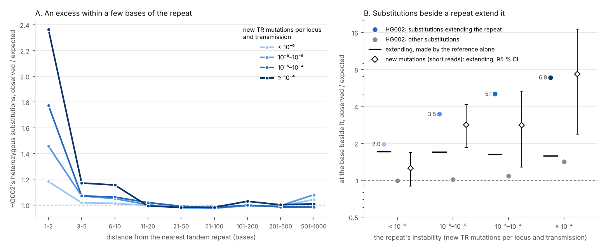

# 10. Do substitutions beside a tandem repeat extend it?

**Question.** Tandem repeats mutate fast, by slippage. Do they also raise
the rate of substitution in the sequence around them, a mutational shadow?
gpxil keeps a person's two haplotypes and the reference base for base, so
every base outside the Platinum TR catalogue's 7.3 million autosomal loci can
be counted by its distance from the nearest repeat, by that repeat's
instability, and by what HG002 carries there, on each haplotype.

**Answers.**

1. **There is no broad shadow.** From 11 to 1,000 bases away from the
   nearest repeat, HG002's heterozygous substitutions run at 0.98 to 1.05
   times what their trinucleotides predict (0.97 to 1.08 in each class of
   instability), beside stable and unstable repeats alike. From 3 to 10
   bases away they run a little high, at 1.01 to 1.17 times, the more beside
   less stable repeats.
2. **Around a repeat, HG002 varies as it varies in the repeat.** Around the
   348,789 loci where one of HG002's haplotypes differs from the reference,
   heterozygous substitutions run at 2.02 to 2.21 times the expected from 11
   to 1,000 bases away. Around the 333,199 where both differ, they run at
   0.87 to 0.91, and around the rest at 0.93 to 1.00. That is shared history,
   not mutation: where HG002's two haplotypes have long been apart, they
   differ in the repeat and around it.
3. **The base right beside a repeat has an excess, almost all of it
   extending the repeat.** At the first base beside a locus, where the
   reference base doesn't continue the repeat, HG002's heterozygous
   substitutions run at 1.31, 1.81, 2.46 and 3.41 times the expected, from
   the most stable class of repeat to the least. Substitutions whose new
   base is the one the repeat would have there next run at 1.97, 3.46, 5.06
   and 6.90 times; the others run at 0.99, 1.02, 1.09 and 1.42 times (beside
   the least stable class, 11 % of the excess is in the others). At the second
   base the excess is smaller (1.06 to 1.69), but bases beyond the first are
   counted only beside loci whose unit is at least that long.
4. **The reference makes part of it.** The reference decides where a repeat
   ends, so its boundary bases include places where it carries a base that
   broke the repeat; HG002's other allele there looks like an extension.
   Under the neutral spectrum of allele frequencies, this alone gives
   extending substitutions at 1.58 to 1.71 times the expected and the others
   at 1.00. It makes most of the excess beside the most stable class (1.71
   of 1.97). Beside the other classes, HG002's extending substitutions run at
   2.0, 3.1 and 4.4 times what the reference makes.
5. **New mutations show it in short-read calls.** New mutations escape the
   reference's effect. Outside low-complexity regions, where Sasani et al.
   called none, and at the first base beside loci expected to gain a new TR
   mutation in one transmission in a million or more, 40 new substitutions
   extend the repeat where 13.1 are expected (3.06; 2.18 to 4.16), and 26
   others don't, where 25.8 are (1.01). By class: 2.83 (26 against 9.2), 2.81
   (9 against 3.2) and 7.33 (5 against 0.7); beside the most stable class,
   1.25 (42 against 33.6; 0.90 to 1.69). All of these are Sasani et al.'s
   short-read calls. The Platinum Pedigree's long-read calls are too few to
   tell: none lies within 2 bases of a locus, where 1.8 are expected. In
   short reads, an inserted unit misaligned at the end of a read can look
   like exactly such a substitution, so these calls agree with HG002 without
   settling it.
6. **Beside pure two-letter runs, the excess is larger.** At the base beside
   each of experiment 09's runs, HG002's heterozygous substitutions run at
   6.3 (purine runs), 8.3 (A/T) and 3.8 (A/C) times the expected, and in
   those three alphabets 86 to 97 % of them extend the run: beside purine
   runs, 541 where 25.2 are expected (21.5 times). New mutations are too few
   to tell. Low-complexity regions cover 26 to 48 % of these bases, and
   outside them 2 new substitutions lie beside runs where 1.0 are expected,
   none of them beside a purine run (0.6 expected).
7. **The haplotypes don't settle where the excess comes from.** Beside loci
   where HG002 varies on one haplotype only, heterozygous substitutions 21 to
   500 bases away are on that haplotype 82 % of the time (shared history
   again), and right beside the locus 75 % of the time (3,983 substitutions).
   Substitutions made in the same event as the repeat's own change would
   raise that share. The excess's own share is 65 %, so at most about a third
   of it could be such substitutions, and only if the rest took no account of
   the haplotypes. The fall can't be read as the excess's alone, though:
   errors of calling or phasing near repeats would lower the share too, and
   isolated substitutions show part of the fall (82 % to 80 %) with almost no
   excess.

**What it means.** Tandem repeats don't raise mutation in the sequence
around them beyond about 10 bases. What they do is lengthen at their edges
by substitution. In HG002, the base beside a repeat turns into the repeat's
next base far more often than the spectrum predicts, the more so the less
stable the repeat, and well beyond what the reference makes by deciding
where repeats end. Short-read new mutations agree, though misaligned
insertions could account for some of them. HG002's genotypes, read against
the reference, overstate such changes unless corrected: the reference alone
makes extending substitutions look 1.6 to 1.7 times commoner than they are.
Bases beside homopolymers were known to vary more, toward the homopolymer's
base (Siddle et al. 2011), and substitutions in A-tracts to gather at their
ends (Bacolla et al. 2015). Here the excess is measured across the
catalogue's repeats and rises with their measured instability. Pure runs of
two letters, Albrecht-Buehler's GA-sequences among them, show the largest
excess in HG002. That is one way they could grow as their Alu elements age
(experiment 09), but new mutations beside them are too few to confirm it.



## How it was done

| Script | What it does | Output |
|---|---|---|
| [`shadow.py`](shadow.py) | counts, at every autosomal base outside the catalogue's loci, the bases and HG002's substitutions by distance to the nearest locus, its instability class and whether HG002 varies in it, by trinucleotide and new base; places the families' new substitutions the same way | `results/shadow.npz`, `results/shadow_counts.json` |
| [`distances.py`](distances.py) | observed against expected by distance; loci where HG002 varies; substitutions in cis or trans | `results/distances.json` |
| [`edges.py`](edges.py) | the first four bases beside each locus and the base beside each pure run: substitutions that extend them, in HG002 and in new mutations | `results/edges.json` |
| [`ascertainment.py`](ascertainment.py) | what the reference makes by itself, by algebra and a Monte Carlo | `results/ascertainment.json` |
| [`figures.py`](figures.py) | the picture | `figures/edges.png` |

- **HG002.** GIAB's v5.0q small-variant benchmark, encoded one autosome a
  file as experiment 04 encoded it (gt and flags planes), read beside the
  reference plane of the Gpxil browser's GRCh38 files. A base is callable
  when it lies in the benchmark's regions and is known on both haplotypes,
  in no deletion or complex allele; 2,351,820,011 of the 2,508,916,262
  bases outside the loci with a known trinucleotide are. A substitution is
  heterozygous when one haplotype holds another base and the other holds
  the reference's; isolated when no other variant (or insertion) lies within
  10 bases. All of v5.0q's variants are phased. HG002 varies in a locus when
  either haplotype holds any variant inside it.
- **Instability.** Each locus's expected rate of new TR mutations per
  transmission comes from experiment 06's Poisson model with class (length,
  motif size, purity and composition class, fitted to the 440 new TR
  mutations of the family's eight G3 children). The four classes are below
  10⁻⁶, 10⁻⁶ to 10⁻⁵, 10⁻⁵ to 10⁻⁴, and 10⁻⁴ or more.
- **Distance.** A base's distance to the nearest locus edge (1 for the base
  touching it), and that locus's class; separately, its distance to the
  nearest locus of each class.
- **Expected counts.** Each base's trinucleotide (read with a pyrimidine in
  the middle) has HG002's rate of heterozygous substitutions per callable
  base, measured 201 bases or more from any locus. New substitutions are set
  against all bases outside low-complexity regions (LCR-hs38, standing in
  for the GRCh37 mask under which Sasani et al. called none), with their own
  rate measured 201 to 1,000 bases from any locus. Farther out lie large
  regions where the two studies called almost none (0.25 times the rate).
- **Extension.** For the first bases beside a locus, up to its shortest
  motif's length p and at most four, the repeat's next base there is the
  one p bases back inside it. Bases where the reference already has that
  base are counted apart. A run of experiment 09 is extended when the new
  base is in its alphabet. Expected extending substitutions are each base's
  rate of turning into that base.
- **The reference's share** is set out in [`ascertainment.py`](ascertainment.py).
  With q the chance that the spectrum turns the base into the repeat's next
  base, and F the mean derived-allele frequency at heterozygous sites (1/3
  under the neutral spectrum), extending substitutions come out at
  1 − F + F/q times the expected, and the others at 1. The Monte Carlo
  re-encodes the same three cases, so it checks the algebra only.
- **New substitutions** are those of the CEPH families (Sasani et al. 2019,
  lifted from GRCh37) and the Platinum Pedigree (Porubsky et al. 2025, lifted
  from T2T-CHM13), read as experiment 07 reads them. The 559 that both call
  count once, and 59 of the Platinum Pedigree's in low-complexity regions are
  left out. 25,323 lie outside the loci with a known trinucleotide, 25,198 of
  them Sasani et al.'s.

## Results

### By distance from the nearest repeat

HG002's heterozygous substitutions, observed / expected, by the nearest
locus's instability (new TR mutations per locus and transmission):

| Distance (bases) | 1-2 | 3-5 | 6-10 | 11-20 | 21-50 | 51-100 | 101-200 | 201-500 | 501-1000 |
|---|---|---|---|---|---|---|---|---|---|
| all loci | 1.30 | 1.03 | 1.03 | 1.00 | 0.98 | 0.99 | 0.99 | 0.99 | 1.05 |
| below 10⁻⁶ | 1.18 | 1.02 | 1.01 | 1.00 | 0.98 | 0.99 | 0.99 | 0.99 | 1.04 |
| 10⁻⁶ to 10⁻⁵ | 1.46 | 1.07 | 1.05 | 1.00 | 0.98 | 0.97 | 0.99 | 0.99 | 1.08 |
| 10⁻⁵ to 10⁻⁴ | 1.77 | 1.07 | 1.06 | 1.02 | 0.99 | 0.98 | 1.00 | 0.98 | 0.98 |
| 10⁻⁴ or more | 2.36 | 1.17 | 1.15 | 0.99 | 0.98 | 0.98 | 1.03 | 1.00 | 1.01 |
| HG002 the same in the locus | 1.17 | 0.96 | 0.96 | 0.94 | 0.93 | 0.93 | 0.94 | 0.95 | 1.00 |
| HG002 varies on one haplotype | 3.67 | 2.43 | 2.36 | 2.21 | 2.11 | 2.07 | 2.07 | 2.02 | 2.08 |
| HG002 varies on both haplotypes | 1.45 | 1.01 | 0.97 | 0.90 | 0.89 | 0.87 | 0.89 | 0.87 | 0.91 |

The distance to the nearest locus of each class alone, whatever lies
between, gives the same: 1.18, 1.46, 1.79 and 2.38 at 1-2 bases, and 0.98
to 1.03 from 11 to 1,000 bases.

New substitutions, outside low-complexity regions, observed / expected (and
observed), by the nearest locus's instability:

| Distance (bases) | 1-2 | 3-5 | 6-10 | 11-20 | 21-50 | 51-100 | 101-200 | 201-500 | 501-1000 |
|---|---|---|---|---|---|---|---|---|---|
| all loci | 1.12 (331) | 1.00 (448) | 0.99 (735) | 1.03 (1,550) | 0.99 (4,188) | 0.99 (5,316) | 1.01 (6,359) | 0.99 (5,371) | 1.05 (861) |
| 10⁻⁴ or more | 3.43 (14) | 1.56 (10) | 1.84 (20) | 1.50 (33) | 1.02 (64) | 1.13 (90) | 0.89 (83) | 1.10 (85) | 1.20 (13) |

Within 20 bases of the least stable repeats, 77 new substitutions lie where
43.4 are expected (1.77; 1.40 to 2.22); from 3 to 20 bases, 63 where 39.3
are (1.60; 1.23 to 2.05).

### The bases beside a locus

Where the reference base doesn't continue the repeat; HG002's heterozygous
substitutions, observed / expected (observed):

| Instability | Base 1: all | Base 1: extending | Base 1: others | Base 1: extending, isolated | Base 2: all | Base 4: all |
|---|---|---|---|---|---|---|
| below 10⁻⁶ | 1.31 (10,789) | 1.97 (5,214) | 0.99 | 1.77 | 1.06 | 1.03 |
| 10⁻⁶ to 10⁻⁵ | 1.81 (4,276) | 3.46 (2,650) | 1.02 | 2.72 | 1.14 | 1.02 |
| 10⁻⁵ to 10⁻⁴ | 2.46 (1,935) | 5.06 (1,377) | 1.09 | 3.33 | 1.19 | 0.95 |
| 10⁻⁴ or more | 3.41 (506) | 6.90 (372) | 1.42 | 4.39 | 1.69 | 1.26 |

Where the reference base already continues the repeat, the first base runs
at 1.04, 1.19, 1.11 and 2.65.

### What the reference makes, and new mutations

| Instability | q | Made by the reference | HG002, extending | Beyond the reference's share | New mutations, extending | New mutations, others |
|---|---|---|---|---|---|---|
| below 10⁻⁶ | 0.320 | 1.71 | 1.97 | 1.15 | 1.25 (42 against 33.6) | 0.94 |
| 10⁻⁶ to 10⁻⁵ | 0.324 | 1.70 | 3.46 | 2.04 | 2.83 (26 against 9.2) | 0.91 |
| 10⁻⁵ to 10⁻⁴ | 0.346 | 1.63 | 5.06 | 3.11 | 2.81 (9 against 3.2) | 1.54 |
| 10⁻⁴ or more | 0.364 | 1.58 | 6.90 | 4.36 | 7.33 (5 against 0.7) | 0 (1.2 expected) |

q is the spectrum's chance that a substitution at such a base extends the
repeat. A spectrum of allele frequencies proportional to f^−a moves what the
reference makes to 1.50 to 1.80 for a from 0.8 to 1.2. All the new
mutations at these bases are Sasani et al.'s; the Platinum Pedigree's calls
would have 0.8 there, and have none.

### Beside pure two-letter runs

| Runs (experiment 09) | Bases | HG002: all | Extending | Share extending (by the spectrum) | New mutations outside low-complexity regions: observed (expected) |
|---|---|---|---|---|---|
| purine/pyrimidine | 72,429 | 6.27 (630) | 21.5 (541 against 25.2) | 86 % (29 %) | 0 (0.6) |
| A/T | 26,112 | 8.32 (190) | 10.1 (184 against 18.2) | 97 % (79 %) | 0 (0.2) |
| A/C | 17,488 | 3.76 (68) | 4.13 (65 against 15.8) | 96 % (85 %) | 2 (0.2) |

The G/C runs' 173 bases hold one substitution, which extends its run.

### Haplotypes

Beside loci where HG002 varies on one haplotype only, the share of
heterozygous substitutions on that haplotype:

| | 1-2 bases | 21-500 bases | 1-2 bases, if the excess ignored the haplotypes |
|---|---|---|---|
| all classes | 0.749 (3,983) | 0.823 | 0.682 |
| below 10⁻⁶ | 0.773 (1,338) | 0.826 | 0.689 |
| 10⁻⁶ to 10⁻⁵ | 0.741 (1,330) | 0.814 | 0.691 |
| 10⁻⁵ to 10⁻⁴ | 0.753 (1,042) | 0.829 | 0.675 |
| 10⁻⁴ or more | 0.663 (273) | 0.845 | 0.637 |
| all classes, isolated | 0.797 (2,086) | 0.820 | 0.806 |

## Caveats

- One person, and one benchmark, which calls 94 % of the bases outside the
  loci.
- The classes of instability come from a model of 440 new TR mutations in
  eight children. The excess is split by instability only, not by motif size
  or composition.
- Bases 2 to 4 are counted only beside loci whose shortest motif is that
  long or longer, so distance from the repeat and the repeat's unit go
  together there.
- The reference's share assumes that the reference and HG002 are drawn from
  one population (GRCh38 is mostly one donor, of other ancestry than
  HG002); that the repeat's last base and the base beside it don't mutate
  more than once (which sits oddly with an edge that mutates fast); that the
  far bases' spectrum, which mixes forward and back changes, gives a new
  mutation's chance of extending; and one spectrum of allele frequencies for
  every change, with no biased gene conversion or selection.
- 25,198 of the 25,323 new substitutions, and all of those beside repeats,
  are Sasani et al.'s short-read calls. Short reads call new mutations least
  reliably next to repeats, missing some and calling some that aren't; an
  inserted unit misaligned at a read's end can look like a substitution
  that extends the repeat. LCR-hs38 stands in for their GRCh37 mask of
  low-complexity regions.
- A locus's ends are where the catalogue's definitions put them; by another
  definition, a base beside a locus can be inside a repeat.
- The expected rates take each base's trinucleotide; longer contexts, such
  as a homopolymer next to the base, aren't modelled.

## Sources

- Siddle KJ, Goodship JA, Keavney B, Santibanez-Koref MF. Bases adjacent to
  mononucleotide repeats show an increased single nucleotide polymorphism
  frequency in the human genome. Bioinformatics. 2011;27(7):895-898.
  doi:[10.1093/bioinformatics/btr067](https://doi.org/10.1093/bioinformatics/btr067).
- Bacolla A, Zhu X, Chen H, Howells K, Cooper DN, Vasquez KM. Local DNA
  dynamics shape mutational patterns of mononucleotide repeats in human
  genomes. Nucleic Acids Res. 2015;43:5065-5080.
  doi:[10.1093/nar/gkv364](https://doi.org/10.1093/nar/gkv364).
- Sasani TA, et al. Large, three-generation human families reveal
  post-zygotic mosaicism and variability in germline mutation accumulation.
  eLife. 2019;8:e46922. doi:[10.7554/eLife.46922](https://doi.org/10.7554/eLife.46922).
- Porubsky D, et al. Human de novo mutation rates from a four-generation
  pedigree reference. Nature. 2025;643:427-436.
  doi:[10.1038/s41586-025-08922-2](https://doi.org/10.1038/s41586-025-08922-2).
- Li H. Toward better understanding of artifacts in variant calling from
  high-coverage samples. Bioinformatics. 2014;30(20):2843-2851.
  doi:[10.1093/bioinformatics/btu356](https://doi.org/10.1093/bioinformatics/btu356)
  (LCR-hs38, from [lh3/varcmp](https://github.com/lh3/varcmp)).
- Platinum TRs v1.0 (Dashnow, [Zenodo 13178746](https://doi.org/10.5281/zenodo.13178746), CC BY 4.0).

## Reproducing

```sh
python3 -I shadow.py REF_DIR HG002_DIR BED FEATURES DNM_DIR CHAIN37 TABLE.xlsx CHAIN_T2T LCR    # 26 min
python3 -I distances.py
python3 -I edges.py REF_DIR HG002_DIR BED FEATURES DNM_DIR CHAIN37 TABLE.xlsx CHAIN_T2T LCR
python3 -I ascertainment.py
python3 figures.py
```

REF_DIR is the Gpxil browser's GRCh38 gpxil files. HG002_DIR holds
HG002_chrN.gpxil.tif from GIAB's v5.0q small-variant VCF, made as experiment
04's `encode_hg002.sh` makes them, and BED is v5.0q's benchmark regions.
FEATURES is experiment 06's locus measures (its `--features` file);
experiment 06's `results/strata.tsv.gz` is read too. DNM_DIR, CHAIN37,
TABLE.xlsx and CHAIN_T2T are experiment 07's inputs, and LCR is
`LCR-hs38.bed.gz` from lh3/varcmp. `edges.py` reads experiment 09's
`results/runs.tsv.gz`. Python 3.12 or later, with gpxiltools 0.8 or later,
NumPy, SciPy, pandas, statsmodels, pyliftover, openpyxl and Matplotlib.
