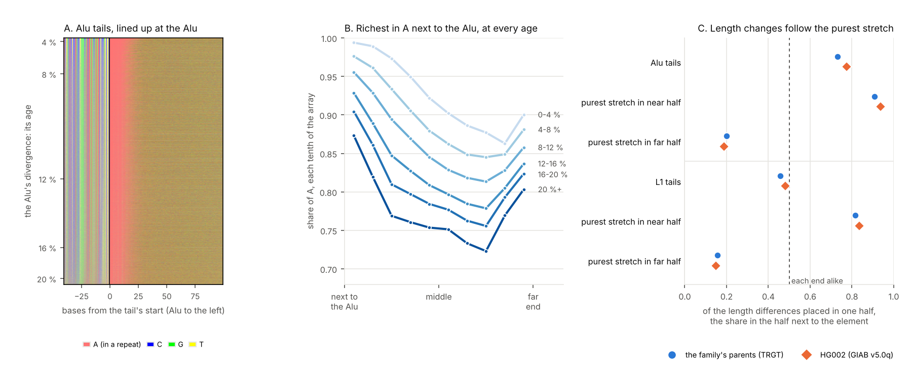

# 11. Where along a repeat array does change happen?

**Question.** A tandem repeat is an array of units, and it changes by
gaining and losing them, and by substitutions that break them. Does that
happen anywhere along the array, or at one end: do arrays grow, or decay,
from one end? An array has no ends to tell apart unless something marks
one. The tail of an Alu or an L1 element does: it begins at the element's
3' end. Lined up there, as Albrecht-Buehler lined up GA-sequences at their
starts (2009), every tail array has a near end, next to the element, and a
far end. gpxil's planes give each array's bases on the element's strand,
and a person's two haplotypes base for base beside them.

**Answers.**

1. **Tails mutate like other repeats of their kind.** Of the catalogue's
   7,270,921 autosomal loci, 566,236 are Alu tails and 82,201 L1 tails:
   they begin within 30 bases of the element's 3' end on its strand (the
   distance experiments 04 and 09 use), at least half of their bases on the
   element's strand are A, and RepeatMasker finds the element's 3' end
   complete (at most 20 bases of its consensus missing). The Alu tails, 7.8
   % of loci, hold 48 of the family's 440 new TR mutations (10.9 %): 1.13
   times what loci of their length, motif size and purity have elsewhere
   (0.84 to 1.50). The 364,475 loci that begin as close to an element's end
   but fail either test, most of them at ends RepeatMasker finds
   incomplete, hold 142 (32 %): 1.35 times (1.14 to 1.59).
2. **In the reference, Alu tails are richest in A next to the Alu, at every
   age.** In Alu tails 0 to 4 % diverged, the tenth of the array next to
   the Alu is on average 99.4 % A and the ninth tenth 86 %; in the
   human-specific subfamilies (AluYa5, Ya8, Yb8 and Yb9; 2,991 tails, 1.0 %
   diverged at the median), 99.3 % and 85 %. The gradient forms early,
   perhaps at insertion; but A-tails change within a million years
   (Roy-Engel et al. 2002), so a fast early decay of the far end can't be
   ruled out. With age the tails lose A all along, least at the two ends:
   from the youngest to the oldest (20 % or more), the near tenth falls by
   12 points, the third by 20, the sixth by 15 and the far tenth by 10. Part
   of that is a change in what the arrays are: 98 % of the youngest tails
   are poly(A) loci, 36 % of the oldest, and within the poly(A) loci the
   falls are 3 to 10 points. In experiment 09's pure purine runs at Alu tails, the
   share of G rises from 4 % next to the Alu to 27 % at the far end in the
   youngest Alus, and from 33 % to 40 % (44 % mid-run) in the oldest; A/T
   runs, with T, go the same way. L1 tails are flatter, and richest in A at
   both ends.
3. **Length changes follow the purest stretch.** Where an allele differs in
   length from the reference, the comparison places the difference in a
   stretch of the array. Of the 186,515 differences of the family's parents
   at 87,697 Alu tails, 65,329 can be placed in at most half the array:
   39,567 in the half next to the Alu and 14,622 in the far half, 2.7 to 1,
   on either strand alike (so not an artefact of how variants are written).
   HG002's haplotypes, called independently, give 54,080 against 15,646,
   3.5 to 1. But the differences follow the array's longest stretch in
   frame (its purest; for a poly(A), its longest run of one base). Where
   that stretch lies wholly in the near half, the family's differences fall
   there 9.9 to 1 (HG002 15.0); where it lies wholly in the far half, they
   fall there 4.0 to 1 (HG002 4.4). Placed differences touch the purest
   stretch 1.43 times as often as stretches as wide put at random (HG002
   1.55; 1.41 over all 355,505 placed differences at any catalogue locus).
4. **Beyond the purest stretch, Alu tails change more at the Alu end while
   they are young; L1 tails don't.** Were changes to follow the purest
   stretch alone, the two ratios above would mirror each other; at Alu
   tails they leave an excess at the near end of 1.57 times (HG002 1.86).
   It is 1.8 to 2.1 in tails up to 12 % diverged (HG002 2.0 to 2.6) and
   fades with age to 0.99 in the oldest (HG002 1.32). Where the two halves
   of the array are about as rich in A (within 5 points), Alu tails still
   change near 1.34 times as often as far (HG002 1.16), L1 tails 0.95 times
   (0.95). At L1 tails the excess is 0.90 (0.94), and overall the far half
   changes a little more often (0.84 and 0.93 to 1). Gains and losses go
   alike (2.6 and 2.9 to 1 at Alu tails).

**What it means.** Arrays change in length where they are purest:
interruptions are known to slow slippage (Ananda et al. 2014), and here
the alleles of two sets of haplotypes differ where the array's purest
stretch lies, at either end. Alu tails hold their purest stretch next to
the Alu, from their youngest, so most of their length changes happen at the
Alu end. Beyond that, young Alu tails change more at the Alu end than their
purest stretch predicts, by 1.8 to 2.6 times up to 12 % divergence, an
excess that fades as they age and that L1 tails don't show; why is not clear, and part of it may be
purity the longest stretch doesn't measure. Substitutions, for their part,
wear the tails down all along their length, least at the ends. So no
array decays from one end, and length changes go mostly where purity is,
which in Alu tails is next to the Alu. The landmark is what makes this
visible: without the Alu to line them up on, an array's two ends can't be
told apart, and polarity can't be asked about.



## How it was done

| Script | What it does | Output |
|---|---|---|
| `tails.py` | Finds the catalogue's loci that begin at an Alu's or an L1's 3' end (RepeatMasker; within 30 bases, on the element's strand), reads each on the element's strand from GRCh38's gpxil files (A in each tenth; the longest stretch in frame), keeps those at least half A at complete ends, and reads the second letter of experiment 09's pure tail runs by tenth; new TR mutations at TE tails, and at the other loci near an end, against experiment 06's strata | `results/tail_loci.tsv.gz`, `results/tails.json` |
| `lengths.py` | The parents' alleles (the Platinum Pedigree's pedigree-consistent TRGT calls) and HG002's haplotypes (GIAB v5.0q, rebuilt from its gpxil files: the gt plane, the insertion flags and the sidecar's inserted sequences) that differ in length from the reference at each tail array; where along the array each difference can lie, read from the element | `results/windows.tsv.gz`, `results/lengths.json` |
| `stacks.py` | gpxiltools' stack: the Alu tails lined up at their near end, youngest Alu first; each column's bases by age | `figures/stack_alu_tails.png`, `results/stack_rows.npy`, `results/stack_profile.json` |
| `figures.py` | The figure | `figures/along_arrays.png` |

The per-array tables, `results/tail_loci.tsv.gz` (19 MB) and
`results/windows.tsv.gz` (5 MB), are written by the scripts and not kept in
the repository.

**Placing a length difference.** An allele that differs from the reference
in length differs somewhere in a stretch of the reference that the two
sequences can't narrow further. For one insertion or deletion, it is the
span of the places the event could be put; otherwise, the bases between
the longest start and the longest end the two share. In a pure array the
stretch is the whole array. A difference is placed when its stretch is at
most half the array, near when the stretch lies in the half next to the
element, far when in the other half. A stretch put at random would be near
as often as far, and would touch the longest stretch in frame with the
chance `lengths.py` computes for each one. The excess at the near end
beyond the purest stretch is the geometric mean of the near-to-far ratios
where the purest stretch lies wholly in the near half and where it lies
wholly in the far half: 1 if changes followed the purest stretch alone.

## Results

New TR mutations of the Platinum Pedigree (eight G3 children) at TE tails,
against loci of the same length, motif size and purity elsewhere:

| Loci | Loci (share) | Mutations (share) | Expected | Ratio (95 % CI) |
|---|---|---|---|---|
| Alu tails | 566,236 (7.8 %) | 48 (10.9 %) | 42.3 | 1.13 (0.84 to 1.50) |
| L1 tails | 82,201 (1.1 %) | 5 (1.1 %) | 3.5 | 1.45 (0.47 to 3.38) |
| either | 648,437 (8.9 %) | 53 (12.0 %) | 46.1 | 1.15 (0.86 to 1.50) |
| near an end, not a tail | 364,475 (5.0 %) | 142 (32.3 %) | 105.0 | 1.35 (1.14 to 1.59) |

Of the 760,533 loci within 30 bases of an Alu's 3' end, 134,420 are at ends
RepeatMasker finds incomplete (with 80 new TR mutations) and 59,877 at
complete ends are less than half A (26); of the 252,379 at L1 ends,
145,728 and 24,450 (34 and 2).

Alu tail arrays in the reference, by the Alu's divergence (the share of A
by tenth of the array, from the tenth next to the Alu, a mean over arrays):

| Divergence | Arrays | Mean length | A, near tenth | A, 6th tenth | A, 9th tenth | A, far tenth | Poly(A) loci | Purest stretch: share of array |
|---|---|---|---|---|---|---|---|---|
| 0-4 % | 8,005 | 30.8 | 0.994 | 0.902 | 0.863 | 0.900 | 98 % | 0.820 |
| 4-8 % | 74,102 | 28.8 | 0.976 | 0.862 | 0.849 | 0.881 | 87 % | 0.744 |
| 8-12 % | 241,414 | 29.5 | 0.955 | 0.829 | 0.828 | 0.858 | 75 % | 0.696 |
| 12-16 % | 158,104 | 31.3 | 0.929 | 0.797 | 0.805 | 0.837 | 59 % | 0.658 |
| 16-20 % | 71,936 | 31.5 | 0.904 | 0.777 | 0.793 | 0.824 | 48 % | 0.643 |
| 20 %+ | 12,675 | 35.1 | 0.873 | 0.751 | 0.769 | 0.803 | 36 % | 0.620 |

The far tenth rises above the eighth and ninth (in the youngest, 0.900
against 0.877 and 0.863): the catalogue's loci tend to end on a unit.

Length differences at tail arrays (placed: the stretch they could lie in
is at most half the array):

| | Differences | Placed | Near half | Far half | Near : far |
|---|---|---|---|---|---|
| Alu, family | 186,515 | 65,329 | 39,567 | 14,622 | 2.71 |
| Alu, HG002 | 241,576 | 81,674 | 54,080 | 15,646 | 3.46 |
| L1, family | 17,628 | 9,618 | 3,468 | 4,114 | 0.84 |
| L1, HG002 | 14,432 | 7,835 | 2,949 | 3,174 | 0.93 |

By where the array's purest stretch lies:

| | Purest stretch wholly in the near half: near : far | Wholly in the far half: near : far | Excess at the near end beyond it |
|---|---|---|---|
| Alu, family | 33,715 : 3,411 (9.88) | 1,124 : 4,507 (0.25) | 1.57 |
| Alu, HG002 | 48,683 : 3,242 (15.02) | 931 : 4,051 (0.23) | 1.86 |
| L1, family | 2,066 : 469 (4.41) | 456 : 2,475 (0.18) | 0.90 |
| L1, HG002 | 1,943 : 386 (5.03) | 366 : 2,090 (0.17) | 0.94 |

At Alu tails, by the Alu's divergence:

| Divergence | Near : far, family | Excess beyond the purest stretch, family | Near : far, HG002 | Excess, HG002 |
|---|---|---|---|---|
| 0-4 % | 1.83 | 1.76 | 2.33 | 2.62 |
| 4-8 % | 3.08 | 2.12 | 3.65 | 2.54 |
| 8-12 % | 3.09 | 1.75 | 3.80 | 1.97 |
| 12-16 % | 2.49 | 1.38 | 3.35 | 1.66 |
| 16-20 % | 2.14 | 1.28 | 2.71 | 1.45 |
| 20 %+ | 1.41 | 0.99 | 2.06 | 1.32 |

## Caveats

- The arrays are the catalogue's loci, whose ends TRsolve chose; an Alu
  tail's far end may take in the target's sequence. The rule that makes an
  array a tail allows its start to lie up to 30 bases from the end
  RepeatMasker gives the element, whose consensus takes in part of the
  poly(A).
- Most differences can't be placed: half of them could lie anywhere in at
  least 79 % of the array (86 % in HG002). The placed ones come from
  interrupted arrays, where slippage is slower. A difference that is more
  than one insertion or deletion (9 % of the family's at Alu tails) is
  placed between the two sequences' shared ends, which can be narrower than
  where its change in length could lie; single events alone give 3.1 to 1
  near (HG002 4.3).
- The purest stretch is the longest stretch in which each base equals the
  base one shortest motif on; for a poly(A), the longest run of one base.
  It is one measure of purity, and the near-end excess may partly be
  purity it misses.
- The family's calls are its pedigree-consistent tandem repeats (TRGT, the
  open-access samples: the G2 couple and five G3 children); they hold only
  one of the 461 loci where the family's paper called a new TR mutation
  that passed its filters, so the new mutations themselves can't be
  placed. The parents' and HG002's alleles differ from the reference by
  history, not one generation's mutation.
- HG002's alleles come from GIAB's small-variant benchmark, whose calls in
  long homopolymers are least sure; only arrays it calls on both
  haplotypes, with the base either side, are counted (622,357 of 648,437).

## Sources

- Albrecht-Buehler G. Outline of a genome navigation system based on the
  properties of GA-sequences and their flanks. PLoS ONE. 2009;4(3):e4701.
  doi:[10.1371/journal.pone.0004701](https://doi.org/10.1371/journal.pone.0004701).
- Ananda G, Hile SE, Breski A, Wang Y, Kelkar Y, Makova KD, Eckert KA.
  Microsatellite interruptions stabilize primate genomes and exist as
  population-specific single nucleotide polymorphisms within individual
  human genomes. PLoS Genet. 2014;10(7):e1004498.
  doi:[10.1371/journal.pgen.1004498](https://doi.org/10.1371/journal.pgen.1004498).
- Roy-Engel AM, et al. Active Alu element "A-tails": size does matter.
  Genome Res. 2002;12(9):1333-1344.
  doi:[10.1101/gr.384802](https://doi.org/10.1101/gr.384802).
- Porubsky D, et al. Human de novo mutation rates from a four-generation
  pedigree reference. Nature. 2025;643:427-436.
  doi:[10.1038/s41586-025-08922-2](https://doi.org/10.1038/s41586-025-08922-2).
- The Platinum Pedigree's pedigree-consistent tandem repeats,
  `variants/tr_truthset/GRCh38/ceph_1463_tandem_repeats.oa.vcf.gz`
  ([AWS Open Data](https://registry.opendata.aws/platinum-pedigree/)).
- Platinum TRs v1.0 (Dashnow, [Zenodo 13178746](https://doi.org/10.5281/zenodo.13178746), CC BY 4.0).
- GIAB HG002 v5.0q small-variant benchmark (GRCh38).
- UCSC Genome Browser, RepeatMasker annotation of hg38 (`rmsk.txt.gz`).

## Reproducing

```sh
python3 -I tails.py REF_DIR RMSK FEATURES                   # 2 min
python3 -I lengths.py REF_DIR HG002_DIR TRGT_VCF FEATURES   # 4 min
python3 -I stacks.py GENOME                                 # 3 min
python3 figures.py
```

REF_DIR is the Gpxil browser's GRCh38 gpxil files and GENOME the same as
one file. RMSK is UCSC's `rmsk.txt.gz` for hg38. FEATURES is experiment 06's
locus measures (its `--features` file). HG002_DIR holds HG002_chrN.gpxil.tif
from GIAB's v5.0q small-variant VCF, made as experiment 04's
`encode_hg002.sh` makes them. TRGT_VCF is the Platinum Pedigree's
`ceph_1463_tandem_repeats.oa.vcf.gz`. `tails.py` reads experiment 09's
`results/runs.tsv.gz`. Python 3.12 or later, with gpxiltools 0.8 or later,
NumPy, pandas and Matplotlib.
