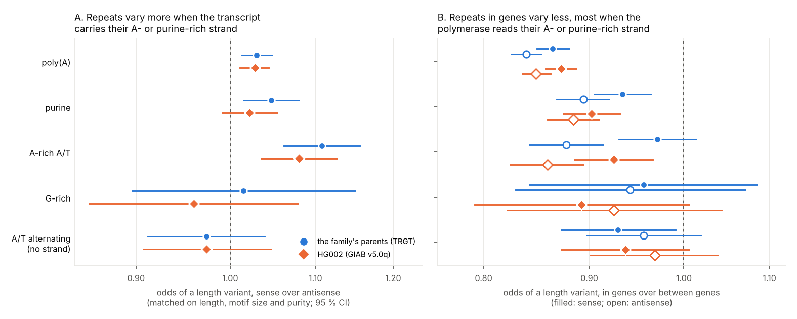

# 12. Do repeats mutate differently depending on which strand is transcribed?

**Question.** A repeat whose two strands differ, a poly(A) or a purine run,
lies in a gene one way or the other: the gene's transcript carries its A-
or purine-rich strand (sense here), or the polymerase reads that strand
and the transcript carries the other (antisense). Transcription treats the
two strands differently: it exposes one as single strand, repair follows
the polymerase on the strand it reads, and the RNA can pair back with the
strand it was copied from. Does a repeat's mutability
depend on its orientation in a gene? Each of the catalogue's 7.3 million
loci has a strand composition that gpxil's 4-bit codes give directly, and
HG002's two haplotypes are read beside it from its gpxil files.

**Answers.**

1. **Repeats in genes vary less than repeats between genes.** In the
   introns of genes on one strand, loci vary less often than loci of the
   same length, motif size and purity between genes: odds ratios of 0.84
   to 0.97 for the four groups whose strands differ, in the family's
   parents and in HG002 alike (the intervals include 1 for the G-rich
   group, and for the A-rich A/T group's sense loci in the family), and
   0.93 to 0.97 for A/T-alternating repeats, whose strands don't.
2. **They vary least when the polymerase reads their A- or purine-rich
   strand.** Sense against antisense, matched on length, motif size and
   purity, the odds of a length variant are 1.030 times as high for poly(A)
   (95 % CI 1.013 to 1.048; HG002 1.028, 1.011 to 1.044), 1.047 times for
   purine repeats (1.015 to 1.080; HG002 1.022, 0.991 to 1.054) and 1.108
   times for A-rich A/T repeats (1.062 to 1.156; HG002 1.080, 1.035 to
   1.127). With a fifth to two-fifths of poly(A) loci varying, an odds ratio
   of 1.03 corresponds to varying about 1.02 times as often. G-rich repeats show no difference (1.015, 0.896 to 1.150; HG002
   0.960), nor do A/T-alternating ones, whose orientation means nothing
   (0.974 and 0.974).
3. **Alu tails don't explain it.** The poly(A) loci at Alu tails
   (experiment 11's) lie in introns more often antisense (81,118) than
   sense (68,203). Within them, the difference is 1.039 (1.013 to 1.065;
   HG002 1.029, 1.006 to 1.053); within the poly(A) loci at neither an
   Alu's nor an L1's tail, 1.030 (1.007 to 1.054; HG002 1.030, 1.007 to
   1.053); at L1 tails, 1.094 (0.964 to 1.243; HG002 1.078).
4. **New TR mutations are too few to tell.** The groups' intronic loci hold
   4 to 44 of the family's new TR mutations each, and no rate ratio of
   sense to antisense is distinguishable from 1. The only rate ratio of the
   12 that can be estimated whose interval excludes 1 runs against answer 1: purine loci,
   antisense against between genes, 1.93 (1.02 to 3.68).

**What it means.** In the germline, genes go with fewer length variants at
repeats. Transcriptional scanning would give that: genes expressed during
spermatogenesis have lower mutation rates on their transcribed strand (Xia
et al. 2020). So would selection at linked sites, which lowers diversity
near genes on both strands alike, as at the strand-symmetric repeats here. The repeats' own strands matter: the
lowering is deepest where the strand the polymerase reads is the A- or
purine-rich one. In cancers the strand asymmetry of indels at poly(T)
tracts runs the other way: somatic indels at poly(T) tracts of 2 to 10
bases are commoner when the poly(T) is on the strand the polymerase
doesn't read (Georgakopoulos-Soares et al. 2020), that is, here,
antisense. The effects are small, a few percent in odds,
and they are of variation, which mutation, selection and history shape
together; but the poly(A) difference is seen in two sets of haplotypes
called by different methods, within Alu tails and outside them, and none
is seen where the orientation means nothing. Genes differ from the DNA between them in more than
transcription (they replicate earlier, for one), so answer 1 shows a
difference, not its cause; answer 2 compares intronic loci only.



## How it was done

| Script | What it does | Output |
|---|---|---|
| `strands.py` | Puts each autosomal locus of the catalogue in a group by how its strands differ (from experiment 06's base counts on the + strand) and by where it lies (Ensembl 116's protein-coding and lncRNA genes: sense, antisense, between genes); whether the family's parents (the Platinum Pedigree's pedigree-consistent TRGT calls) or HG002 (its v5.0q gpxil files: deletions inside the locus, insertions after its bases or the base before it, loci called on both haplotypes with the base either side) have a length variant; new TR mutations (experiment 06); Mantel-Haenszel odds and rate ratios within experiment 06's strata of length, motif size and purity; the same within the loci at Alu and L1 tails (experiment 11) and elsewhere | `results/strands.json`, `results/loci.tsv.gz` |
| `figures.py` | The figure | `figures/transcription.png` |

The per-locus table, `results/loci.tsv.gz` (20 MB), is written by
`strands.py` and not kept in the repository.

**The groups.** On the strand richer in the group's letters:

| Group | Rule | Loci |
|---|---|---|
| poly(A) | one strand 90 % A or more | 550,930 |
| purine | one strand 90 % purines or more, not a poly(A) | 926,982 |
| A-rich A/T | 90 % A or T, at least three-quarters of one strand's A and T being A, not in the groups above | 406,829 |
| G-rich | one strand at least 60 % G and at most 10 % C, not in the groups above | 280,870 |
| A/T alternating (control) | 90 % A or T, neither A nor T more than 60 % of the A and T | 199,937 |

**Where.** Sense or antisense: inside genes of one strand only (Ensembl's
gene bodies), no nearer than 100 bases to an exon of them (splice sites'
polypyrimidine tracts are under selection). Between genes: no gene of
either kind on either strand. Loci in genes on both strands, or near exons,
are left out (1,274,322 of all loci).

## Results

By group and where the locus lies: loci, and the share with a length
variant in the family's parents and in HG002 (of the loci it calls); the
family's new TR mutations.

| Group | Where | Loci | Family | HG002 | New TR mutations |
|---|---|---|---|---|---|
| poly(A) | sense | 143,561 | 22.75 % | 37.76 % | 5 |
| | antisense | 184,552 | 22.13 % | 37.25 % | 2 |
| | between genes | 134,780 | 25.22 % | 40.17 % | 3 |
| purine | sense | 231,762 | 3.97 % | 5.41 % | 13 |
| | antisense | 277,051 | 4.57 % | 6.57 % | 31 |
| | between genes | 246,567 | 4.81 % | 6.79 % | 15 |
| A-rich A/T | sense | 98,404 | 5.36 % | 5.98 % | 2 |
| | antisense | 134,382 | 5.22 % | 6.07 % | 4 |
| | between genes | 113,671 | 5.49 % | 6.24 % | 4 |
| G-rich | sense | 81,913 | 0.74 % | 0.90 % | 3 |
| | antisense | 75,690 | 0.75 % | 0.99 % | 1 |
| | between genes | 68,561 | 0.77 % | 0.99 % | 1 |
| A/T alternating | sense | 57,598 | 4.42 % | 5.61 % | 13 |
| | antisense | 55,617 | 4.55 % | 5.90 % | 11 |
| | between genes | 57,543 | 4.81 % | 6.00 % | 9 |

The raw shares can mislead: the purine group's antisense loci are longer
on average than its sense loci, and longer loci vary more. The odds
ratios, matched on length, motif size and purity:

| Group | Sense vs antisense: family | HG002 | Sense vs between genes: family | HG002 | Antisense vs between genes: family | HG002 |
|---|---|---|---|---|---|---|
| poly(A) | 1.030 (1.013-1.048) | 1.028 (1.011-1.044) | 0.864 (0.849-0.880) | 0.872 (0.857-0.887) | 0.839 (0.825-0.853) | 0.848 (0.835-0.862) |
| purine | 1.047 (1.015-1.080) | 1.022 (0.991-1.054) | 0.934 (0.905-0.964) | 0.902 (0.874-0.931) | 0.894 (0.868-0.920) | 0.884 (0.859-0.910) |
| A-rich A/T | 1.108 (1.062-1.156) | 1.080 (1.035-1.127) | 0.971 (0.930-1.014) | 0.925 (0.885-0.966) | 0.877 (0.842-0.914) | 0.859 (0.824-0.894) |
| G-rich | 1.015 (0.896-1.150) | 0.960 (0.854-1.079) | 0.956 (0.842-1.085) | 0.892 (0.792-1.006) | 0.942 (0.829-1.071) | 0.925 (0.821-1.043) |
| A/T alternating | 0.974 (0.912-1.039) | 0.974 (0.907-1.047) | 0.929 (0.872-0.991) | 0.937 (0.872-1.006) | 0.956 (0.897-1.019) | 0.968 (0.901-1.039) |

Sense against antisense, within the loci at TE tails (experiment 11) and
elsewhere (family; HG002):

| Group | Alu tails | L1 tails | Elsewhere |
|---|---|---|---|
| poly(A) | 1.039 (1.013-1.065); 1.029 (1.006-1.053) | 1.094 (0.964-1.243); 1.078 (0.950-1.224) | 1.030 (1.007-1.054); 1.030 (1.007-1.053) |
| purine | 1.050 (0.997-1.105); 1.046 (0.996-1.097) | 1.070 (0.846-1.353); 0.906 (0.710-1.156) | 1.050 (1.009-1.093); 1.012 (0.972-1.054) |
| A-rich A/T | 1.181 (1.087-1.283); 1.127 (1.039-1.222) | 1.138 (0.992-1.305); 1.134 (0.987-1.302) | 1.074 (1.019-1.133); 1.051 (0.996-1.110) |

## Caveats

- Variation, not mutation: a parent's or HG002's allele differs from the
  reference by history, which selection and drift shape as well as
  mutation. The new mutations, which would show mutation alone, are too
  few in these loci.
- The effects are a few percent in odds, and many groups and comparisons
  were made. Only the poly(A) difference has intervals that exclude 1 in
  both sets of haplotypes, within Alu tails and outside them; the purine
  group's includes 1 in HG002, and so do the A-rich A/T group's outside
  TE tails in HG002.
- The family's calls are its pedigree-consistent tandem repeats (TRGT,
  the open-access samples): a locus is listed only where one of seven
  people has a non-reference allele and the calls fit inheritance through
  the pedigree. A locus not listed counts as without a variant in the
  parents, whether or not TRGT called it.
- HG002's calls are GIAB's small-variant benchmark, least sure in long
  homopolymers; only loci it calls on both haplotypes are counted.
- Gene bodies are Ensembl's, whatever their expression in the germline;
  testis expression, where transcriptional scanning acts, isn't used.
  Where in a gene a locus lies (near its start, where transcription's
  effects on mutation are strongest) isn't examined.
- The strata are coarse: within a stratum, the groups' loci can still
  differ a little in length or purity.

## Sources

- Xia B, Yan Y, Baron M, Wagner F, Barkley D, Chiodin M, Kim SY, Keefe DL,
  Alukal JP, Boeke JD, Yanai I. Widespread transcriptional scanning in the
  testis modulates gene evolution rates. Cell. 2020;180(2):248-262.e21.
  doi:[10.1016/j.cell.2019.12.015](https://doi.org/10.1016/j.cell.2019.12.015).
- Georgakopoulos-Soares I, Koh G, Momen SE, Jiricny J, Hemberg M,
  Nik-Zainal S. Transcription-coupled repair and mismatch repair contribute
  towards preserving genome integrity at mononucleotide repeat tracts. Nat
  Commun. 2020;11:1980.
  doi:[10.1038/s41467-020-15901-w](https://doi.org/10.1038/s41467-020-15901-w).
- Porubsky D, et al. Human de novo mutation rates from a four-generation
  pedigree reference. Nature. 2025;643:427-436.
  doi:[10.1038/s41586-025-08922-2](https://doi.org/10.1038/s41586-025-08922-2).
- Platinum TRs v1.0 (Dashnow, [Zenodo 13178746](https://doi.org/10.5281/zenodo.13178746), CC BY 4.0).
- Ensembl release 116, `Homo_sapiens.GRCh38.116.gtf.gz`.
- GIAB HG002 v5.0q small-variant benchmark (GRCh38).

## Reproducing

```sh
python3 -I strands.py GTF CATALOG_FEATURES TRGT_VCF REF_DIR HG002_DIR    # 6 min
python3 figures.py
```

GTF is Ensembl's `Homo_sapiens.GRCh38.116.gtf.gz`. CATALOG_FEATURES is
experiment 06's locus measures with base counts (R, Y, W, S, M, K, acgt).
TRGT_VCF is the Platinum Pedigree's `ceph_1463_tandem_repeats.oa.vcf.gz`.
REF_DIR and HG002_DIR are as in experiment 10. `strands.py` reads
experiment 06's strata (through its code) and experiment 11's
`results/tail_loci.tsv.gz`. Python 3.12 or later, with gpxiltools 0.8 or
later, NumPy, pandas and Matplotlib.
