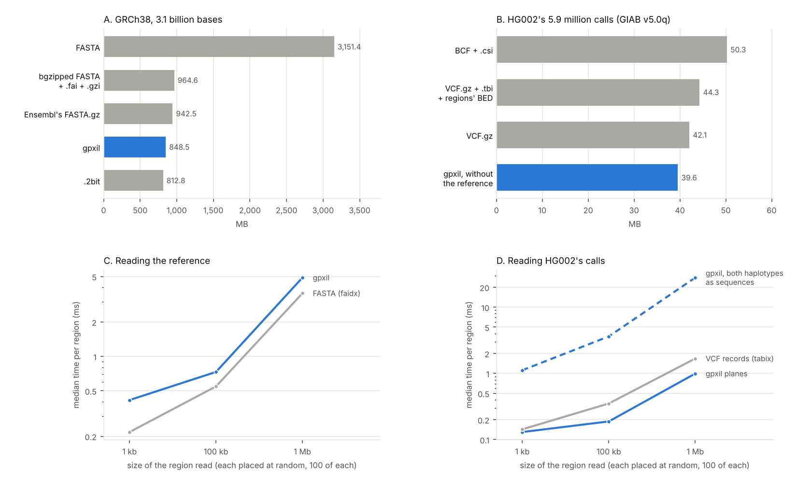

# 13. A whole genome in and out of gpxil: what it keeps, what it takes, how fast it reads

**Question.** The software article says that a gpxil file is a lossless
record of a person's two haplotypes, smaller than the files it stands for and
quick to read in pieces. Is that so for a whole genome, checked by tools that
share none of gpxiltools' code?

**Answers.**

1. **A whole genome encodes in 7 minutes, and is valid.** GIAB's HG002
   v5.0q small-variant benchmark (5,945,525 records) became a gpxil file of
   HG002 alone on GRCh38 in 407 s, peaking at 1.87 GB of memory on two
   cores, and `gpxil validate` passed it in 36 s and 224 MB (24 contigs, no
   errors or warnings). No REF allele disagreed with the reference by the
   specification's test, in which N matches any base (one record's REF
   allele is N where Ensembl's GRCh38 has bases: below), and no two calls
   conflicted; 74,017 `*` alleles were left to the deletions they
   point at, and 42 bases of X and Y's haploid regions have diploid calls,
   which the specification lets stand.
2. **Its haplotypes are the VCF's.** Read back, each haplotype matched
   the one bcftools consensus builds from the VCF at all 5,350,862,029
   haplotype bases compared (both haplotypes of 24 chromosomes; the
   627,778,759 the gpxil leaves unknown pass), except at 3,720 sites, and at
   every one of them the VCF contradicts itself and the two tools settle it
   differently. At 3,312, two records put overlapping alleles on one
   haplotype: bcftools leaves out a record whose allele overlaps one it has
   already applied (69,806 records, 4,456 of them with a real allele and the
   others with a `*`, which changes nothing), and gpxil keeps the variant
   bases of both (specification section 6.4). At 408, a `*` allele has no deletion on its haplotype, and
   bcftools writes the `*` into the sequence as a character, where gpxil
   writes nothing. There is no difference of any other kind.
3. **The export says the same in nearly the same records.** After normalising both, 5,438,650 of
   the VCF's 5,469,075 alleles (99.44 %) come back from the export exactly,
   phase included, and 5,438,016 of those with the same filter status. Of
   the 30,425 that don't, 26,662 are where the two files say the same
   haplotypes in other records, most often because the export writes
   overlapping events of the two haplotypes as one record, which normalising
   doesn't split as the VCF had them; 3,760 are at the haplotype differences
   above; and 3 have an N in their ALT allele. The export holds 5,297,663
   records besides 1,579,317 no-call blocks; atomised, it counts 7,144,974
   alleles, since one record written differently can split into many.
4. **Encoded again, the export gives the same haplotypes.** On every chromosome the export,
   encoded again, gave the same two haplotypes as the first file, N
   included, with no conflicts. Its planes differ at 1,830,468 bases in 7,977
   stretches (0.06 % of the genome): where the export wrote overlapping
   events as one record, the encoder aligned each allele afresh
   (specification section 6.2) and wrote the same haplotype with other
   states, an insertion and a deletion becoming substitutions, say, or a
   deletion moving inside a stretch the file doesn't know. The sidecars
   differ for the same reason (700,634 entries against 699,215). Two flags
   belong to records in a VCF and to bases in gpxil: an exported record that
   covers any filtered base is marked filtered, so FILTERED spreads over
   436,257 more bases, and the no-call blocks are records, so the flag for
   bases covered by a call spreads over the unknown regions.
5. **It is smaller than the files it stands for.** HG002 alone takes
   39.6 MB as gpxil (gt 17.6 MB, flags 15.4 MB, sidecar 6.2 MB), against
   42.1 MB for the VCF.gz as GIAB distributes it, which needs its index
   (1.5 MB) and the benchmark regions' BED (0.7 MB) to say what the gpxil
   says, and 48.9 MB as BCF (with a 1.4 MB index). GRCh38 as one gpxil file
   takes 848.5 MB (its reference plane, soft-masking included, 848.0 MB; the
   Gpxil browser's 26 files together, 848.5 MB), against 812.8 MB for a .2bit
   (computed exactly; GRCh38 has no IUPAC code but N, so a .2bit loses
   nothing here), 942.5 MB for Ensembl's FASTA.gz, 964.6 MB for a bgzipped
   FASTA with the indexes faidx needs, and 3,151.4 MB uncompressed.
6. **It reads a region about as fast as faidx and tabix do.** With the files
   in the operating system's cache, the median read of the reference took
   0.42 ms for 1 kb, 0.73 ms for 100 kb and 4.9 ms for 1 Mb, against 0.22,
   0.55 and 3.6 ms from the bgzipped FASTA. HG002's calls, as planes and
   insertions, took 0.13, 0.19 and 0.99 ms, against 0.14, 0.35 and 1.7 ms
   for the VCF's records with their genotypes (1, 175 and 1,733 records in
   the median region); both haplotypes spelt out as sequences took 1.1, 3.6
   and 28 ms. Opening the sample's file took 0.4 ms, the VCF with its index
   58 ms. Over the web, from the Gpxil browser's chromosome files on GitHub
   Pages, a region read from a newly opened file cost a median of 0.7 MB
   (1 kb), 1.0 MB (100 kb) and 0.9 MB (1 Mb) in three or four HTTP range
   requests, and 0.8 to 1.0 s; the files read are 22 to 71 MB.

**What it means.** A gpxil file holds a call set's
haplotypes exactly: a separate tool, given the VCF, builds the same two
sequences at every base, except where the VCF contradicts itself, and there
the specification's rules decide, as they say they will. What the file
doesn't keep is the VCF's way of writing them: records come back merged where
the two haplotypes' events overlap, so a file read back is the same genome in
other records, and encoding the export again gives the same haplotypes but
not always the same per-base states. For a whole genome the file is smaller
than the VCF that went into it, and a region comes out of it about as fast as
from the indexed text formats, as whole sequences rather than records.

## How it was done

**Encoding.** `roundtrip.py encode` ran

    gpxil encode GRCh38.gpxil.tif -v HG002_GRCh38_v5.0q_smvar.vcf.gz \
        --callable HG002_GRCh38_v5.0q_smvar.benchmark.bed --sex XY --no-ref \
        -o HG002_v5.0q.gpxil.tif

and then `gpxil validate`, each in a process of its own whose wall time and
peak resident memory were recorded (gpxiltools 0.8.2, Python 3.13, two
cores). The reference is the Gpxil browser's GRCh38 as one file, from which
the encoder reads each chromosome's bases; the output holds HG002's planes
and the reference's digests, not its bases.

**Haplotypes against bcftools.** For each of chromosomes 1 to 22, X and Y,
`roundtrip.py check` exported the chromosome's reference from the GRCh38
gpxil as FASTA and built each haplotype from the VCF with `bcftools
consensus -H 1` and `-H 2` (bcftools in pysam 0.24.1), a separate
implementation of applying a VCF to a reference. It read the same haplotype
from the gpxil with gpxiltools (UNKNOWN and COMPLEX bases as N, deleted and
ABSENT bases dropped, insertions after their anchors) and compared the two.
bcftools needs the reference the VCF was made on, and GIAB's differs from
Ensembl's at one record: chr9:70,701,801, a homozygous deletion whose REF
allele is a T and 17,993 N, where Ensembl's GRCh38 has bases. gpxil reads N
in a REF allele as any base (specification section 6.7) and applied the
deletion; bcftools consensus and norm refuse it, so they were given the
chromosome's FASTA with those bases masked too. The two were compared:
base for base between insertions and deletions, and, around each, the
stretch from the base before to the base after as a whole, so that an indel
the two place at different ends of a repeat still matches; where the two
change the length by different amounts, the stretch took in the next ones,
up to 10,000 bases, until they agreed again. N in either haplotype
(nothing known: UNKNOWN in the gpxil's, a masked base in bcftools') matches
anything. Bases where haplotype 2 is ABSENT (X and Y
outside the pseudoautosomal regions in a male) were not compared. Every
difference was then set against what bcftools reports: the records it
leaves out because they overlap an allele it has already put on the
haplotype, and the `*` characters it writes into the sequence.

**Records.** `gpxil vcf` exported each chromosome (with its no-call blocks),
and the export and the VCF's own records were both normalised by `bcftools
norm -a --atom-overlaps . -m -any -f` (left-aligned, multiallelic records
split, complex ones atomised) and compared as multisets of (position, REF,
ALT, genotype with its phase), leaving out `*` alleles, no-call blocks and
genotypes without an ALT allele. A record of one that the other lacks is
then set against the haplotype comparison: within the span of a
difference, or else the same haplotypes said in other records, those with
an N in their ALT allele counted apart.

**Again.** The export was encoded again (`gpxil encode ... --sex XY --no-ref
--contigs`, without callable regions: the no-call blocks carry them), and
its haplotypes (as above, N included) and planes compared with the first
file's.

**Sizes and reads.** `sizes.py` measured the files and the stored bytes of
each plane; worked out a .2bit's size exactly from the sequence (a header,
an index entry a sequence, and for each two bits a base and eight bytes for
each run of N and of soft-masked bases); and wrote the VCF as BCF with
`bcftools view -Ob` and indexed it. `access.py` wrote GRCh38 from the gpxil
as a bgzipped FASTA (pysam's BGZFile, 60 bases a line) indexed by faidx, and
read 100 regions of each size, placed at random (seed 13) on chromosomes 1
to 22 in proportion to their lengths, from each file opened once, after one
pass over the 1 kb regions so that the first regions aren't the ones that
fetch the pages; the two references were checked to give the same bases.
Then 5 regions of each size were read from the Gpxil browser's chromosome
files over HTTPS, each from a newly opened file.

## Results

| Chromosome | VCF records | alleles back as written | haplotype bases compared | differences: overlapping alleles, stray `*` | again: same haplotypes | gt bases differing again | seconds |
|---|---:|---:|---:|---|---|---:|---:|
| chr1 | 447,447 | 411,643 of 413,318 (99.59 %) | 431,084,265 | 248, 46 | yes | 186,683 | 153 |
| chr2 | 399,483 | 392,827 of 394,177 (99.66 %) | 464,491,332 | 192, 17 | yes | 71,440 | 104 |
| chr3 | 407,765 | 381,070 of 384,899 (99.01 %) | 385,403,399 | 267, 16 | yes | 91,920 | 113 |
| chr4 | 392,164 | 375,280 of 381,049 (98.49 %) | 370,390,292 | 261, 14 | yes | 229,171 | 206 |
| chr5 | 339,220 | 336,289 of 339,287 (99.12 %) | 348,502,301 | 303, 18 | yes | 107,553 | 98 |
| chr6 | 338,070 | 322,408 of 323,805 (99.57 %) | 333,787,463 | 195, 7 | yes | 91,622 | 86 |
| chr7 | 341,571 | 317,929 of 319,290 (99.57 %) | 295,119,632 | 212, 6 | yes | 180,335 | 110 |
| chr8 | 276,511 | 274,166 of 275,173 (99.63 %) | 270,995,917 | 299, 5 | yes | 57,052 | 72 |
| chr9 | 293,149 | 239,815 of 241,278 (99.39 %) | 215,988,828 | 53, 8 | yes | 26,289 | 69 |
| chr10 | 273,014 | 271,125 of 272,021 (99.67 %) | 251,535,649 | 172, 3 | yes | 56,255 | 69 |
| chr11 | 247,768 | 252,238 of 253,480 (99.51 %) | 256,235,890 | 126, 7 | yes | 54,537 | 64 |
| chr12 | 242,076 | 244,247 of 245,324 (99.56 %) | 256,576,324 | 92, 4 | yes | 40,351 | 61 |
| chr13 | 329,535 | 220,455 of 221,162 (99.68 %) | 188,328,064 | 140, 95 | yes | 21,295 | 64 |
| chr14 | 162,286 | 161,127 of 161,575 (99.72 %) | 168,721,267 | 129, 2 | yes | 75,579 | 66 |
| chr15 | 171,248 | 164,271 of 164,843 (99.65 %) | 155,076,659 | 66, 6 | yes | 44,499 | 47 |
| chr16 | 198,155 | 168,250 of 168,788 (99.68 %) | 145,606,173 | 110, 5 | yes | 145,624 | 110 |
| chr17 | 168,809 | 158,503 of 159,259 (99.53 %) | 148,365,815 | 63, 6 | yes | 26,005 | 48 |
| chr18 | 154,112 | 154,243 of 154,767 (99.66 %) | 145,268,915 | 116, 5 | yes | 20,110 | 37 |
| chr19 | 120,428 | 119,774 of 120,248 (99.61 %) | 108,265,809 | 76, 3 | yes | 69,736 | 40 |
| chr20 | 179,633 | 132,449 of 133,729 (99.04 %) | 116,992,708 | 112, 9 | yes | 87,423 | 63 |
| chr21 | 113,870 | 78,693 of 78,909 (99.73 %) | 66,932,535 | 31, 99 | yes | 4,617 | 25 |
| chr22 | 106,073 | 76,417 of 77,014 (99.22 %) | 63,320,044 | 35, 12 | yes | 132,872 | 126 |
| chrX | 157,970 | 147,949 of 148,198 (99.83 %) | 147,693,550 | 10, 0 | yes | 9,500 | 51 |
| chrY | 85,168 | 37,482 of 37,482 (100.00 %) | 16,179,198 | 4, 15 | yes | 0 | 18 |

Totals, from `results/check_summary.json`: bcftools applied 7,405,920
alleles; the comparison took 1,384,541 stretches around insertions and
deletions as wholes, of which 1,753 differ, and found 2,083 single bases
that differ between them, all at the 3,720 sites above. Exporting each
chromosome's VCF took 272 s in all (peak 0.57 GB; 313 MB of VCF with the
no-call blocks), and encoding the exports again 483 s (peak 1.60 GB).
Memory is given in GB of 10⁹ bytes, from the peak resident size.

## Caveats

- bcftools consensus is a yardstick only where the VCF is consistent. Where
  two records put overlapping alleles on one haplotype, it keeps the first
  and leaves out the rest, and gpxil's precedence rules (specification
  section 6.4) keep the variant bases of both; neither is the "right"
  haplotype. Where a `*` allele has no deletion on its haplotype (GIAB's
  filtered records do this, with the deletion's own genotype missing),
  bcftools writes a `*` into the sequence and gpxil writes nothing.
- The comparison passes over the bases the gpxil doesn't know (N), which
  are mostly those outside the benchmark regions. Inside them, and at every
  call outside them, it compares every base.
- A VCF made on a reference that masks bases the gpxil's reference has will
  have N in REF alleles there, and gpxil accepts them without a word, as the
  specification says (N matches any base). GIAB's v5.0q has one such record;
  counting REF alleles whose N meets a base, apart from the mismatches, would
  let a writer say that the VCF's reference was not quite its own.
- The record comparison counts alleles after atomising, so one record the
  export writes differently from the VCF can count as many.
- Times are from one machine with two cores, Python 3.13 and the files in
  the page cache; the web reads went through this machine's proxy, and a
  browser's numbers are in experiment 01. faidx and tabix are called through
  pysam, so their times include its overhead, as gpxiltools' include
  Python's.
- The size of Ensembl's FASTA.gz is the one recorded in gpxiltools'
  benchmarks (the file was not downloaded again); the .2bit's is computed,
  not written.

## Sources

- GRCh38: Ensembl release 116, `Homo_sapiens.GRCh38.dna_sm.primary_assembly.fa.gz`,
  as the Gpxil browser's gpxil files (one file and one a chromosome).
- HG002: GIAB's v5.0q small-variant benchmark,
  `HG002_GRCh38_v5.0q_smvar.vcf.gz` (md5 c71acc71069bf7cd7f51eb8fb0c1a1ab),
  its index and `HG002_GRCh38_v5.0q_smvar.benchmark.bed` (md5
  3366858af85875cbb3c579412ffa4c56).
- bcftools and htslib as bundled in pysam 0.24.1 (Danecek et al. 2021).

## Reproducing

    REF=GRCh38.gpxil.tif
    VCF=HG002_GRCh38_v5.0q_smvar.vcf.gz
    BED=HG002_GRCh38_v5.0q_smvar.benchmark.bed
    python3 -I roundtrip.py encode $REF $VCF $BED work    # 7 min, 1.9 GB
    python3 -I access.py $REF work/HG002_v5.0q.gpxil.tif $VCF work
    python3 -I sizes.py $REF Gpxil-browser/site/data/grch38/gpxil work/HG002_v5.0q.gpxil.tif $VCF $BED work
    python3 -I roundtrip.py check $REF $VCF work          # 32 min
    python3 -I roundtrip.py summary
    python3 figures.py

`results/` holds what each step wrote: `encode.json`, `access.json`,
`sizes.json`, `check.json` (each chromosome) and `check_summary.json` (the
totals), with the commands' logs.
